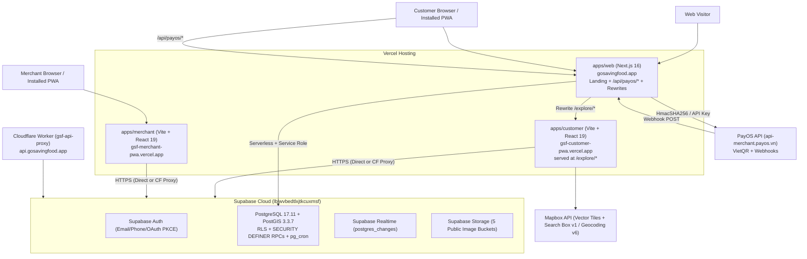
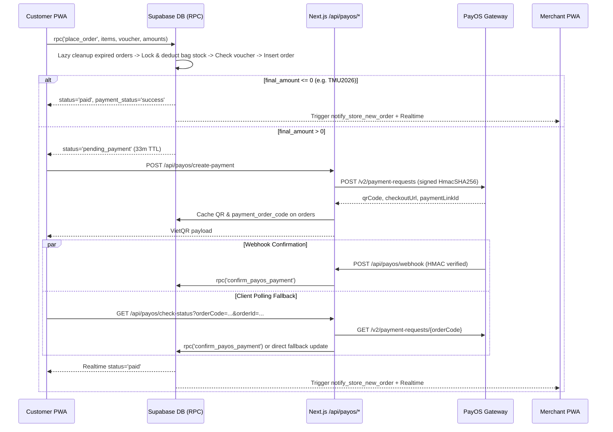

# ARCHITECTURE.md — GoSavingFood System Architecture

> **Source of truth**: Reflects actual verified implementation (`CONFIRMED`). Replaces legacy aspirational `docs/architecture.md`.

---

## 1. System Context (`CONFIRMED`)

GoSavingFood consists of three independently deployable web applications inside a `pnpm` + `Turborepo` monorepo, backed by Supabase (PostgreSQL + PostGIS + Auth + Realtime + Storage), Next.js serverless routes for PayOS VietQR, Mapbox for maps/geocoding, and a Cloudflare Worker proxy for Supabase traffic.

---

## 2. Technology Stack (`CONFIRMED`)

| Layer | Technology | Notes from `package.json` |
| :--- | :--- | :--- |
| Monorepo | `pnpm@11.13.1`, `turbo@^2.10.12` | Workspaces: `apps/*`, `packages/*` |
| Landing & API Host (`apps/web`) | Next.js `16.3.3`, React `19.2.8`, Tailwind CSS v4, GSAP | TypeScript `ignoreBuildErrors: true` in `next.config.ts` |
| Customer PWA (`apps/customer`) | Vite `8.2.2`, React `19.2.8`, TypeScript `~6.0.2`, `mapbox-gl`, `qrcode.react` | **No** `react-router`, **no** TanStack Query, **no** Zod/MSW |
| Merchant PWA (`apps/merchant`) | Vite `8.2.2`, React `19.2.8`, TypeScript `~6.0.2`, `html5-qrcode` | **No** `react-router`, **no** TanStack Query |
| Shared UI (`packages/ui`) | React + CSS design tokens (`@gosavingfood/ui`) | `Badge`, `Button`, `Card`, `Dialog`, `EmptyState`, `ErrorState`, `Input`, `Skeleton` |
| Database & BaaS | Supabase (`@supabase/supabase-js@^2.117.2`), PostgreSQL `17.11`, PostGIS `3.3.7` | `pg_cron`, `pgcrypto`, `uuid-ossp`, `supabase_vault` |
| Edge / Proxy | Cloudflare Worker (`scripts/deploy-worker.mjs`) | Proxies `api.gosavingfood.app` -> `lblwvbedtlxjtkcuxmsf.supabase.co` |
| Payments | PayOS v2 REST API | Server-only in `apps/web/app/api/payos/*` |
| Maps & Geocoding | Mapbox GL JS + Search Box v1 / Geocoding v6 & v5 | Client-side token (`VITE_MAPBOX_TOKEN`) |
| Testing | Vitest `5.0.5` + Node `.mjs` audit scripts | Unit tests + live Supabase integration suites |

---

## 3. Components & Responsibilities (`CONFIRMED`)

### `apps/web` (Next.js 16 App Router)
- **Landing UI (`app/page.tsx`, `app/components/*`)**: Marketing sections, impact calculator, food marquee, Android/iOS PWA install modal.
- **PWA / OAuth Redirectors**:
  - Standalone PWA launch on `/` redirects to Customer App (`/explore/`).
  - `/auth/callback/page.tsx` forwards OAuth query/hash tokens to `/explore/` (or `localhost:5173/explore/` locally).
- **Gateway Rewrites (`next.config.ts`)**: Rewrites `/explore/*` to `CUSTOMER_APP_URL` (`https://gsf-customer-pwa.vercel.app`) and `/merchant/*` to `MERCHANT_APP_URL` (`https://gsf-merchant-pwa.vercel.app`); redirects `www.gosavingfood.app` -> `gosavingfood.app` and `/customer/*` -> `/explore/*`.
- **PayOS API Host (`app/api/payos/*`)**: Holds `PAYOS_*` and `SUPABASE_SERVICE_ROLE_KEY` secrets to create payment links, process webhooks, poll PayOS status, cancel links, and clean up expired pending orders.

### `apps/customer` (Vite + React SPA/PWA)
- **Feature-Oriented Structure**: `src/features/{auth,cart,catalog,checkout,home,location,notifications,orders,profile,search}/`.
- **State-Based Routing (`src/App.tsx`)**: Uses React state (`AppRoute`) + `window.history.pushState/popstate` rather than `react-router`. Heavy screens (`SearchPage`, `SelectLocationPage`, `CheckoutPage`, `PaymentPage`, `OrderDetailPage`, etc.) are `React.lazy` code-split (`mapbox-gl` chunk isolated and excluded from modulePreload).
- **Auth (`src/contexts/AuthContext.tsx`)**: PKCE flow (`flowType: 'pkce'`), 0ms synchronous render from `localStorage` (`gsf_cached_customer_user`), persistent storage request, profile completeness gate.
- **Service Layer (`src/services/customer.service.ts`, `mapbox.service.ts`, `supabase.ts`)**: Wraps Supabase queries, RPCs, storage uploads, PayOS Next.js API calls, and embeds `HANOI_BAGS` fallback dataset (~4,956 lines).

### `apps/merchant` (Vite + React SPA/PWA)
- **Page/Domain Structure**: `src/{pages,components,hooks,services,types,utils,mocks}/`.
- **Tab-Based Routing (`src/App.tsx`)**: Switches between `'login' | 'setup' | 'bags' | 'orders' | 'analytics' | 'settings'` synced with `?tab=` URL query param.
- **Hooks (`src/hooks/*`)**: `useAuth`, `useStoreProfile`, `useBags`, `useOrders`, `useNotifications`, `useAnalytics` — manage 60-second `localStorage` TTL/SWR caches, re-sync when `storeId` changes, and subscribe to Supabase Realtime.
- **QR Verification**: Global draggable QR scanner button (`DraggableQRFab`) + `html5-qrcode` calling `verify_pickup_qr` RPC.

### `apps/admin` (`PLANNED` / Not created)
- No application directory, `package.json`, or source code exists yet (`PLANNED`).

### `packages/ui`
- Shared React UI components and CSS tokens (`tokens.css`, `components.css`). `INFERRED` partially adopted (`apps/customer` and `apps/merchant` still contain significant custom CSS in `src/index.css`).

---

## 4. Core Request, Auth & Payment Flows (`CONFIRMED`)

### Authentication Flow
- **Customer**: Supports Email+Password, Phone+Password (resolves phone to email via `get_email_by_phone` RPC), and OAuth PKCE (redirecting through `/auth/callback` to `/explore/`).
- **Merchant**: Email/Phone+Password via Supabase Auth -> resolves owned store (`stores.owner_user_id = user.id` or `create_store` RPC) -> routes to `FirstTimeSetupScreen` if profile/coordinates incomplete, otherwise `bags` tab.

### Order & PayOS VietQR Flow

---

## 5. Background Jobs, Storage & Caching (`CONFIRMED`)

- **Background Jobs (`pg_cron` + SQL)**:
  - `expire_unpaid_orders()` (documented in `0027` as scheduled every 5 minutes via `pg_cron`): calls `cleanup_expired_pending_orders()` to expire unpaid orders past 33m TTL and restore stock/vouchers.
  - `expire_noshow_orders()`: closes `ready_for_pickup` orders > 15m past `pickup_end` and restores dry-food stock.
  - `cron_daily_bag_cycle()`, `expire_stale_surprise_bags()`, `cleanup_expired_idempotency_keys()`.
  - *Note*: `apps/web/app/api/payos/cleanup-expired/route.ts` also exposes an HTTP endpoint called by `customerService.cleanupExpiredPendingOrders()` to cancel expired PayOS links alongside DB cleanup.
- **Storage**: 5 public Supabase Storage buckets (`avatars`, `bag-images`, `bag-photos`, `store-assets`, `store-logos`), 5 MB limit, image MIME types only. Client compresses images before upload (`imageCompression.ts` in customer; binary blob upload in merchant).
- **Caching**:
  - **PWA Service Workers (`public/sw.js`)**: Network-first for HTML navigation with offline fallback to `./index.html`; Cache/SWR for static assets; strict NetworkOnly bypass for Supabase endpoints and `/api/*`.
  - **Client `localStorage`**: 0ms Auth user snapshots (`gsf_cached_customer_user`, `gsf_merchant_cached_user`), Merchant SWR caches (60s TTL for bags/orders/profile), Customer coordinates/location.
  - **Server In-Memory**: `inFlightRequests` `Map` in `apps/web/app/api/payos/create-payment/route.ts` deduplicates concurrent requests per `orderId` within the same serverless instance; DB caches `payos_qr_code` for 33 minutes.
- **Queue**: None (`CONFIRMED` — no Redis/BullMQ/SQS; relies on DB transactions, triggers, and Supabase Realtime).

---

## 6. Deployment, Network & Trust Boundaries (`CONFIRMED`)

- **Network Boundaries**:
  - Public Internet -> Vercel (`gosavingfood.app`, `gsf-customer-pwa.vercel.app`, `gsf-merchant-pwa.vercel.app`).
  - Customer `/api/*` on `gsf-customer-pwa.vercel.app` is rewritten to `https://gosavingfood.app/api/:path*` (`apps/customer/vercel.json`).
  - `api.gosavingfood.app` -> Cloudflare Worker -> `lblwvbedtlxjtkcuxmsf.supabase.co`.
- **Trust Boundaries**:
  - **Browser Clients (`customer`, `merchant`)**: Untrusted environment; hold only `SUPABASE_ANON_KEY` (hardcoded fallback + env) and `VITE_MAPBOX_TOKEN`. Rely on Supabase RLS and `SECURITY DEFINER` RPCs.
  - **Next.js API (`apps/web/app/api/payos/*`)**: Trusted server boundary holding `SUPABASE_SERVICE_ROLE_KEY` and `PAYOS_*` secrets. *(See `docs/SECURITY.md` for missing caller auth on non-webhook routes.)*
  - **PostgreSQL (`public` schema)**: Enforces RLS on all 16 tables; `SECURITY DEFINER` functions cross privilege boundaries (`auth.users`, stock/voucher mutations).
