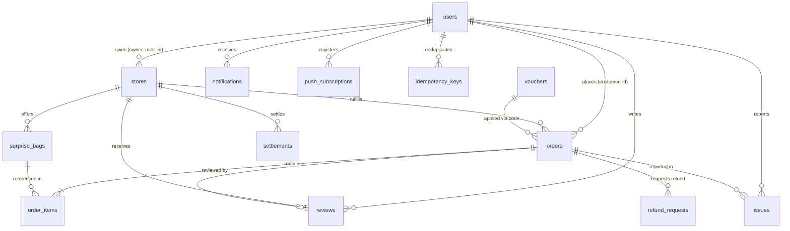

# DATA_MODEL.md — Database Schema & Data Lifecycle

> **Engine**: PostgreSQL `17.11` + PostGIS `3.3.7` on Supabase (`CONFIRMED` from `scripts/db-inspect.mjs` DB snapshot taken `2026-10-24` & `supabase/migrations/0009`–`0041`).
> **Note**: Migrations `0040` and `0041` (`is_hidden` on `vouchers`) were added after the `2026-10-24` snapshot. Regenerate raw inspection locally to `scratch/supabase-backend-raw.md` via `node scripts/db-inspect.mjs`.

---

## 1. Entity Relationship Diagram (`CONFIRMED`)

---

## 2. Core Tables & Key Fields (`CONFIRMED`)

| Table | Purpose | Key Identifiers & Critical Columns |
| :--- | :--- | :--- |
| **`users`** | App profiles synced from `auth.users` via `handle_new_user` trigger | `id` (PK, = `auth.users.id`), `name`, `email`, `phone`, `avatar_url`, `role` (`user_role`), `store_id`, `preferences` (`jsonb`), `deleted_at` |
| **`stores`** | Partner merchants/restaurants | `id` (PK), `owner_user_id` (FK -> `users`), `name`, `phone`, `address`, `location` (`geography(Point,4326)`), `latitude`, `longitude`, `logo_url`, `banner_url`, `rating`, `total_ratings`, `status` (`merchant_status`), `commission_rate`, `food_categories` (`text[]`), `open_time`, `close_time`, `is_open`, `deleted_at` |
| **`surprise_bags`** | Surplus food listings | `id` (PK), `store_id` (FK), `name`, `original_price`, `discount_price`, `category` (`bag_category`), `image_url`, `quantity`, `max_quantity`, `pickup_start`, `pickup_end`, `is_daily`, `is_available`, `bag_type` (`daily` \| `shelf_life`), `repeat_mode`, `daily_quota`, `expiry_date`, `status` (`active`/`sold_out`/etc.), `expires_at`, `deleted_at` |
| **`orders`** | Customer reservations & payment state | `id` (PK), `customer_id` (FK), `store_id` (FK), `total_original_price`, `total_discount_price`, `discount_amount`, `final_amount`, `voucher_code`, `status` (`order_status`), `payment_method`, `payment_status`, `qr_code`, `pickup_token` (`uuid`), `pickup_time`, `payment_order_code` (`bigint` for PayOS), `payment_link_id`, `checkout_url`, `payment_expires_at`, `paid_at`, `payos_qr_code`, `payos_description`, `payos_account_number`, `recipient_name`, `recipient_phone`, `cancel_reason`, `cancelled_at`, `completed_at`, `deleted_at` |
| **`order_items`** | Line items per order | `id` (PK), `order_id` (FK), `bag_id` (FK), `bag_name`, `quantity`, `unit_price`, `total_price` |
| **`vouchers`** | Promo & 100% discount codes | `id` (PK), `code` (unique), `discount_type` (`percentage`\|`fixed`), `discount_value`, `min_order_value`, `max_discount`, `quantity`, `used_count`, `start_date`, `end_date`, `is_active`, `is_hidden` (added in `0041`), `deleted_at` |
| **`notifications`** | In-app realtime alerts | `id` (PK), `user_id` (FK), `icon`, `title`, `body`, `data` (`jsonb`), `is_read`, `deleted_at` |
| **`reviews`** | Customer feedback per order/store | `id` (PK), `order_id`, `customer_id`, `store_id`, `rating`, `comment`, `deleted_at` |
| **`refund_requests`** | Refund queue for cancelled paid orders | `id` (PK), `order_id`, `customer_id`, `amount`, `bank_account_info` (`jsonb`), `status`, `reason` |
| **`idempotency_keys`** | Prevents duplicate order placement | `id` (PK), `user_id`, `key`, `request_hash`, `response` (`jsonb`), `expires_at` (7-day TTL) |
| **`banners`** | Home promotional banners | `id`, `title`, `image_url`, `target_type`, `target_id`, `display_order`, `is_active`, `start_date`, `end_date` |
| **`issues`** | Order dispute/issue reports (`PLANNED` UI) | `id`, `order_id`, `reporter_id`, `reporter_role`, `title`, `description`, `images`, `status` (`issue_status`), `resolution` |
| **`settlements`** | Merchant periodic payouts (`PLANNED` UI) | `id`, `store_id`, `period_start`, `period_end`, `total_orders`, `gross_sales`, `commission_rate`, `commission_amount`, `payment_fee`, `net_payout`, `status`, `paid_at` |
| **`push_subscriptions`** | Web Push endpoints (`PLANNED`) | `id`, `user_id`, `endpoint`, `p256dh`, `auth`, `user_agent` |
| **`admin_audit_logs`** | Admin action log (`PLANNED` UI) | `id`, `admin_id`, `admin_name`, `action`, `entity_type`, `entity_id`, `changes`, `ip_address` |
| **`_migrations`** | Custom SQL migration tracker | `id`, `name`, `run_at` |

---

## 3. Enum Types (`CONFIRMED`)
- **`user_role`**: `customer`, `merchant`, `admin`
- **`merchant_status`**: `active`, `suspended`, `deleted`
- **`bag_category`**: `bakery`, `beverage`, `vegetarian`, `meat`, `seafood`, `raw_food`, `other`
- **`order_status`**: `pending`, `confirmed`, `preparing`, `ready_for_pickup`, `picked_up`, `completed`, `cancelled`, `refund_requested`, `refunded`, `pending_payment`, `paid`, `expired`
- **`payment_method`**: `zalopay`, `momo`, `banking`, `cash`, `payos_vietqr` *(Note: `cash` is rejected by RPC)*
- **`payment_status`**: `pending`, `success`, `failed`, `refunded`, `refund_pending`
- **`voucher_discount_type`**: `percentage`, `fixed`
- **`issue_status`**: `pending`, `resolved`, `rejected`
- **`reporter_role`**: `customer`, `merchant`

---

## 4. Database Triggers & Data Lifecycle (`CONFIRMED`)

- **Soft Deletes**: Core business tables (`users`, `stores`, `surprise_bags`, `orders`, `order_items`, `reviews`, `vouchers`, `issues`) use `deleted_at` timestamp; account deletion (`delete_user_account`) performs hard deletes across related rows + `auth.users`.
- **Triggers**:
  1. `auth.users` -> `on_auth_user_created` -> `handle_new_user()` (syncs auth signup to `public.users`).
  2. `surprise_bags` -> `auto_deactivate_surprise_bag` -> `auto_deactivate_bag()` (sets `sold_out`/`is_available=false` at `quantity <= 0`; restores `active`/`is_available=true` when `quantity > 0` unless `archived` or deleted).
  3. `orders` -> `notify_store_new_order` (after insert or update of `payment_status, status` -> inserts merchant notification when paid).
  4. `orders` -> `notify_customer_order_status` (after update of `status` -> inserts customer notification).
  5. `orders` -> `stamp_order_cancelled_at` (populates `cancelled_at`).
  6. `reviews` -> `update_store_rating_after_review` -> `update_store_rating()` (recalculates `stores.rating` and `stores.total_ratings`).
  7. `update_*_updated_at` -> `update_updated_at_column()` on `orders`, `reviews`, `stores`, `surprise_bags`, `users`, `vouchers`.

### Order State Machine (`CONFIRMED` from `0032`, `0040`, & live `transition_order_status_transaction`)

```mermaid
stateDiagram-v2
    [*] --> pending_payment : place_order (final_amount > 0)
    [*] --> paid : place_order (final_amount <= 0 / 100% voucher)
    pending_payment --> paid : PayOS webhook / check-status
    pending_payment --> expired : 33m TTL (lazy cleanup / pg_cron / cleanup-expired)
    pending_payment --> cancelled : Customer or Merchant cancels (restores stock + voucher)
    paid --> preparing : Merchant accepts
    paid --> cancelled : Customer/Merchant cancels (restores stock + voucher + refund_requests if >0đ)
    preparing --> ready_for_pickup : Merchant marks ready
    preparing --> cancelled : Merchant cancels (reason required)
    ready_for_pickup --> completed : verify_pickup_qr / Merchant completes
    ready_for_pickup --> expired : No-show > 15m past pickup_end (restores dry-food stock; store keeps revenue)
    ready_for_pickup --> cancelled : Merchant cancels (reason required)
```

---

## 5. Tenant & Ownership Model (`CONFIRMED`)
- **Single-Tenant Marketplace with Store Isolation**:
  - Customers are scoped by `orders.customer_id = auth.uid()`.
  - Merchants are scoped 1:1 by `stores.owner_user_id = auth.uid()`. Store-owned entities (`surprise_bags`, `orders`, `order_items`, `settlements`) are isolated via `store_id` ownership checks in RLS.

## 6. Sensitive Data (`CONFIRMED`)
- **PII**: `users.email`, `users.phone`, `orders.recipient_name`, `orders.recipient_phone`, `refund_requests.bank_account_info` (`jsonb`), `push_subscriptions.p256dh` & `auth`, `admin_audit_logs.ip_address`.
- **Tokens**: `orders.pickup_token` (cleared on cancel/expire), `orders.payos_qr_code` (cleared on cancel/complete/expire).

## Payment lifecycle migration 0042

New nullable orders.payos_account_name/payos_bin preserve provider display details. A service-only sequence and row-locked reserve_payos_payment allocate a stable payment_order_code before external requests; it never rotates on reopening/retry. create_order_transaction gives new reservations 33 minutes even near pickup closing. Young pending rows with shorter TTL are extended to created_at + 33 minutes; terminal orders are not revived.

confirm_payos_payment is service-only and idempotent: repeated paid confirmation does not create refund requests or regress fulfillment; repeated late confirmation creates at most one refund per order. Genuine additional/overpayment detection requires distinct provider transaction reconciliation and must not be inferred from repeated polling/webhooks.
