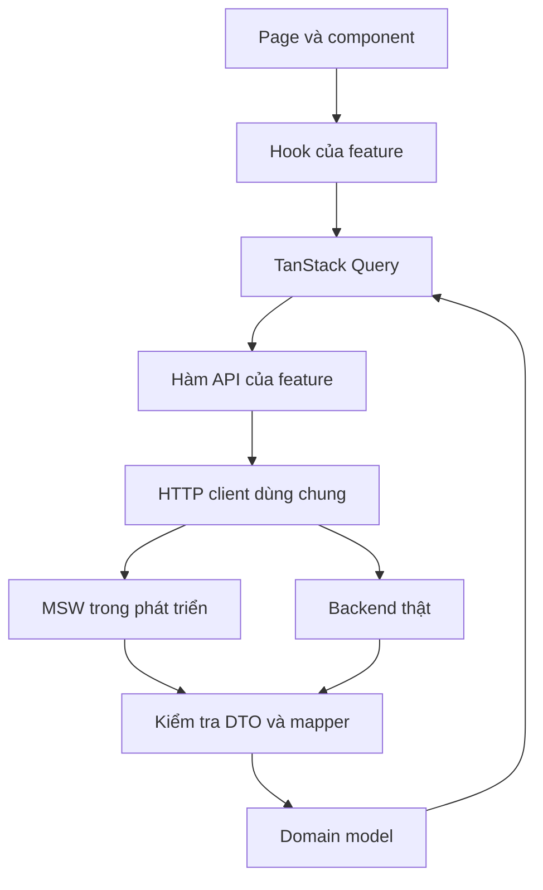

# GoSavingFood — Frontend Architecture

> Vị trí đề xuất trong repository: `docs/architecture.md`.
> Phạm vi: landing page, Customer PWA và Merchant PWA.
> Trạng thái: kiến trúc mục tiêu cho giai đoạn thiết kế giao diện và tích hợp backend sau này.

Tài liệu này xác định code đặt ở đâu, các tầng giao tiếp thế nào và phần nào được dùng chung. Mục tiêu là phát triển nhanh bằng AI, giữ giao diện nhất quán, làm việc nhóm thuận tiện và thay mock bằng API thật mà hạn chế sửa UI.

Kiến trúc dựa trên cấu trúc nhìn thấy trong ảnh: `apps/web`, `apps/customer`, `apps/merchant`, `packages`, pnpm workspace và Turbo. Nội dung bên trong các package chưa được kiểm tra; các đường dẫn bổ sung dưới đây là quy ước cần áp dụng dần, không khẳng định đã tồn tại. Giữ tên package và cấu hình đang hoạt động nếu chúng có vai trò tương đương.

## 1. Các quyết định cốt lõi

1. Một monorepo, ba ứng dụng có thể build và triển khai riêng.
2. `web` dùng Next.js; `customer` và `merchant` dùng React + Vite + TypeScript.
3. Customer và Merchant tổ chức theo feature; dùng chung nền tảng UI và design tokens.
4. Component hiển thị nhận dữ liệu qua props; page lấy dữ liệu qua hook của feature.
5. TanStack Query quản lý dữ liệu server; React state quản lý trạng thái giao diện cục bộ.
6. Hàm API luôn đi qua HTTP client; MSW giả lập phản hồi HTTP trong môi trường phát triển.
7. Dữ liệu ngoài ứng dụng được kiểm tra và chuyển đổi sang domain model trước khi đến UI.
8. Không tạo đồng thời hai hệ thống mock: MSW và các lớp `MockRepository`/`ApiRepository` cho cùng một chức năng.
9. Chỉ tạo abstraction, package hoặc thư mục khi có code thực sự cần đặt vào đó.
10. Backend quyết định quyền truy cập, giá cuối cùng, tồn kho và trạng thái đơn hàng.

## 2. Ranh giới của từng ứng dụng

| Ứng dụng | Trách nhiệm | Công nghệ | Triển khai |
| --- | --- | --- | --- |
| `apps/web` | Landing page, nội dung giới thiệu, SEO, liên kết mở hai app | Next.js App Router | Một project riêng |
| `apps/customer` | Khám phá cửa hàng/sản phẩm, giỏ hàng, đặt hàng, đơn hàng, tài khoản | React + Vite, React Router, PWA | Một project riêng |
| `apps/merchant` | Quản lý cửa hàng, sản phẩm, tồn kho và đơn hàng | React + Vite, React Router, PWA | Một project riêng |

Các nhóm nghiệp vụ trên là ranh giới tổ chức code; chưa phải danh sách tính năng bắt buộc triển khai ngay. Thanh toán, giao nhận và báo cáo chi tiết cần yêu cầu riêng trước khi xây dựng.

Landing page dẫn đến hai URL ứng dụng, không import mã nguồn của Customer hoặc Merchant. Mỗi PWA có manifest, icon, tên ứng dụng và service worker riêng. Có thể phát triển trên các cổng 3000, 5173, 5174 như ảnh; production lấy URL từ cấu hình môi trường.

Ưu tiên ba origin riêng khi triển khai để tách phạm vi service worker và bộ nhớ trình duyệt. Cùng repository không đồng nghĩa dùng chung phiên đăng nhập hoặc localStorage. SSO chỉ bổ sung khi backend có thiết kế hỗ trợ.

Chưa tạo app Admin. Nếu phát sinh vai trò này, xác định phạm vi rồi mới quyết định thêm `apps/admin`.

## 3. Công nghệ và phạm vi sử dụng

| Công nghệ | Vai trò | Quy tắc |
| --- | --- | --- |
| pnpm workspaces + Turborepo | Quản lý package và tác vụ monorepo | Một lockfile ở root |
| TypeScript | Kiểm tra kiểu | Bật strict; không dùng `any` để bỏ qua contract |
| Tailwind CSS + shadcn/ui | Styling và nền tảng component | Component dùng chung thuộc `packages/ui` |
| React Router | Routing Customer/Merchant | Khai báo route tập trung trong từng app |
| TanStack Query | Query, mutation, cache dữ liệu server | Không sao chép dữ liệu server sang global store |
| Zod | Kiểm tra DTO và dữ liệu form khi cần | Đặt validation ở ranh giới dữ liệu |
| React Hook Form | Form có nhiều trường/validation | Chỉ thêm vào feature có nhu cầu |
| MSW | Mock API ở tầng HTTP | Chỉ bật trong môi trường được cấu hình rõ |
| Zustand | Client state dùng chung nhiều màn hình | Tùy chọn; không cần cho mọi feature |
| Storybook | Xem component và các trạng thái độc lập | Bổ sung dần tại `packages/ui` |
| Vitest + Testing Library; Playwright | Kiểm thử logic, UI và luồng chính | Tập trung vào hành vi và rủi ro |

Giữ các phiên bản tương thích đang dùng trong repo. Pin phiên bản pnpm thực tế ở `packageManager` và đồng bộ với lockfile/CI; không nâng cấp toàn bộ stack chỉ để áp dụng tài liệu này.

## 4. Cấu trúc repository

| Đường dẫn | Nội dung |
| --- | --- |
| `apps/web/app/` | Route, layout, metadata của Next.js; giữ đường dẫn hiện tại |
| `apps/web/components/` | Section và component riêng của landing page |
| `apps/web/lib/` | Cấu hình và helper riêng của web khi cần |
| `apps/customer/src/` | Mã nguồn Customer theo cấu trúc ở mục 5 |
| `apps/merchant/src/` | Mã nguồn Merchant theo cùng quy ước |
| `packages/ui/src/` | Component nền tảng, design tokens, style dùng chung |
| `packages/types/src/` | Domain type được nhiều app/package sử dụng |
| `packages/api/src/` | HTTP client, chuẩn lỗi, API/mapper thực sự dùng chung |
| `packages/config/` | Cấu hình TypeScript, ESLint dùng chung nếu chưa có package tương đương |
| `docs/architecture.md` | Tài liệu này |
| `pnpm-workspace.yaml` | Phạm vi workspace |
| `turbo.json` | Tác vụ, dependency và cache build |

`packages/api` không phải backend; nó là thư viện truy cập dữ liệu phía frontend. Chỉ đưa API nghiệp vụ vào đây khi được nhiều app dùng cùng contract. Không biến package này thành nơi chứa mọi hook và logic của cả dự án.

Ban đầu đặt token tại `packages/ui/src/styles/tokens.css`; chưa cần package `design-tokens` riêng. Nếu repo đã có package token/config tương đương thì sử dụng lại, không tạo bản sao.

Các tài liệu `design-system.md`, `app-flow.md`, `ai-rules.md` có thể bổ sung sau. File này không quy định bảng màu chi tiết hay toàn bộ luồng màn hình.

## 5. Cấu trúc một PWA

Áp dụng cho cả `apps/customer/src` và `apps/merchant/src`.

| Đường dẫn tương đối | Trách nhiệm |
| --- | --- |
| `main.tsx` | Bootstrap; chờ MSW sẵn sàng khi bật mock rồi mount React |
| `app/App.tsx` | Ghép provider và router |
| `app/providers/` | QueryClient, auth/session và provider cấp app |
| `app/router/` | Route, lazy loading, guard, trang 404 |
| `app/layouts/` | App shell, header, bottom navigation/sidebar |
| `app/config/` | Đọc và kiểm tra biến môi trường |
| `app/pwa/` | Đăng ký service worker, trạng thái cập nhật và offline |
| `features/<feature>/` | Code nghiệp vụ theo tính năng |
| `shared/components/` | Component dùng giữa các feature của riêng app |
| `shared/lib/` | HTTP client đã cấu hình và helper không phụ thuộc feature |
| `shared/hooks/` | Hook tiện ích không mang nghiệp vụ cụ thể |
| `mocks/` | Worker, HTTP handler, fixture và kịch bản mock |

Các nhóm feature dự kiến:

| Customer | Merchant |
| --- | --- |
| `auth`, `home`, `products`, `stores` | `auth`, `dashboard`, `products` |
| `cart`, `checkout`, `orders`, `profile` | `orders`, `store` |

Chỉ tạo `inventory` hoặc `analytics` riêng khi chức năng đủ lớn; tồn kho đơn giản có thể thuộc `products`.

### 5.1. Cấu trúc một feature

Ví dụ `features/products/`:

| File/thư mục | Trách nhiệm |
| --- | --- |
| `pages/ProductListPage.tsx` | Điều phối dữ liệu và trạng thái màn hình |
| `components/ProductCard.tsx` | Hiển thị sản phẩm qua props và callback |
| `hooks/useProducts.ts` | Query, mutation, query key và invalidation |
| `api/product.api.ts` | Gọi HTTP, parse DTO, map sang domain model |
| `api/product.schema.ts` | Schema phản hồi/request theo contract |
| `api/product.mapper.ts` | Hàm thuần chuyển DTO sang domain model khi cần |
| `types.ts` | Kiểu chỉ thuộc feature này |
| `index.ts` | Public exports dành cho phần khác của app |

Không bắt buộc tạo đủ mọi file từ đầu. Mapper nhỏ có thể ở cùng file API; chỉ tách khi giúp dễ đọc hoặc kiểm thử. Logic nghiệp vụ thuần phức tạp có thể thêm `model/`; không thêm tầng service/repository chỉ để chuyển tiếp lời gọi.

Tên component/page dùng PascalCase; hook bắt đầu bằng `use`; file API/schema/mapper dùng tên domain rõ ràng. Test đặt cạnh phần được kiểm thử, ví dụ `product.mapper.test.ts`.

### 5.2. Trường hợp riêng của Next.js

`apps/web/app/` vẫn là nơi định nghĩa route; không ép web dùng React Router hoặc sao chép cấu trúc PWA. Nội dung công khai ưu tiên Server Component và prerender khi phù hợp. Component tương tác dùng ranh giới `'use client'` nhỏ; không chuyển toàn bộ landing page sang client chỉ vì một nút tương tác. Tham khảo [Next.js: Server and Client Components](https://nextjs.org/docs/app/getting-started/server-and-client-components).

Không truy cập `window`/`localStorage` ở top-level của package dùng chung. Logic hoặc biến môi trường chỉ dành cho server không được export qua entry point dành cho trình duyệt.

## 6. Quy tắc dependency và chia sẻ code

### 6.1. Hướng phụ thuộc

| Thành phần | Được phụ thuộc | Không được phụ thuộc |
| --- | --- | --- |
| `app/` | Feature public API, shared, package | Mã nguồn app khác |
| `features/*` | Nội bộ feature, shared, package | `app/`, nội bộ feature khác |
| `shared/` | Shared khác và package | `features/`, `app/`, mocks |
| `packages/ui` | Token, thư viện UI; domain type nếu component dùng chung cần | API client, router của app, auth store |
| `packages/api` | `packages/types`, schema/HTTP utility | React UI, app config, feature, mocks |
| `packages/types` | Type/schema độc lập khi cần | App, UI, hook, HTTP client |
| `mocks/` | Fixture, contract/schema và helper mock | UI/page/hook để tạo dữ liệu |

`main.tsx` được import động bootstrap mock. Test và Storybook được dùng handler/fixture; đây là code hỗ trợ phát triển, không phải luồng hiển thị production.

Feature khác chỉ import qua `index.ts`; không deep import vào thư mục nội bộ. Nếu hai feature cần nhau hai chiều, chuyển phần chung xuống `shared/` hoặc ghép tại `app/`. `index.ts` không phải nơi export tất cả file; tránh kéo toàn bộ feature vào bundle khi chỉ cần một thành phần.

Đường dẫn alias nội bộ app dùng `@/…`; package dùng workspace import, ví dụ `@gosavingfood/ui`. Tên scope là quy ước đề xuất; ưu tiên scope đang dùng trong repo. Không import xuyên app bằng đường dẫn tương đối.

### 6.2. Chọn nơi đặt component

| Trường hợp | Nơi đặt |
| --- | --- |
| Chỉ dùng trong một feature | `features/<feature>/components` |
| Nhiều feature trong một app sử dụng | `shared/components` |
| Nhiều app dùng cùng giao diện và hành vi | `packages/ui` |

`Button`, `Input`, `Dialog`, `Badge`, `Skeleton`, `EmptyState`, `ErrorState` là các ứng viên dùng chung. Customer ProductCard và Merchant ProductRow có thể khác nhau vì phục vụ tác vụ khác nhau; không ép thành một component có quá nhiều cờ điều kiện.

Component trong `packages/ui` nhận props/callback; navigation do app truyền vào. Token ngữ nghĩa như `primary`, `surface`, `text-muted` được định nghĩa tập trung. Mỗi app nhập stylesheet nền một lần và cấu hình Tailwind quét source package dùng chung theo phiên bản đang cài.

## 7. Luồng dữ liệu chuẩn

Hai nhánh MSW/backend là hai chế độ nguồn phản hồi; một request không lấy dữ liệu từ cả hai. Hook trả dữ liệu, loading và error cho page. Component trình bày chỉ nhận phần dữ liệu cần hiển thị.

### 7.1. Ranh giới dữ liệu

- **DTO**: định dạng request/response trên đường truyền; thuộc API layer.
- **Domain model**: cấu trúc ổn định mà frontend sử dụng; thuộc feature hoặc `packages/types` nếu dùng chung.
- **View model**: dữ liệu hiển thị riêng của màn hình, ví dụ nhãn giá; tạo trong selector/helper của feature, không sửa DTO.

HTTP client xử lý base URL, header, timeout/cancellation và lỗi HTTP. JSON được coi là `unknown` trước khi parse; TypeScript interface hoặc ép kiểu không thay thế kiểm tra runtime. API layer kiểm tra schema rồi map sang domain model. Không xử lý tên trường backend trong JSX.

Ví dụ backend trả `product_name` thì mapper chuyển thành `name`. Mapper không tự điền giá/tồn kho mặc định để che response sai; dữ liệu bắt buộc không hợp lệ phải tạo lỗi có thể xử lý.

### 7.2. Quy ước model

| Dữ liệu | Quy ước nội bộ |
| --- | --- |
| ID | Chuỗi; không dùng index mảng làm định danh nghiệp vụ |
| Tiền VND | Số nguyên đồng; định dạng bằng helper chung khi hiển thị |
| Thời điểm | ISO 8601 có `Z` hoặc offset; hiển thị theo múi giờ cửa hàng/người dùng |
| Số lượng | Số nguyên không âm; backend xác nhận giá trị cuối cùng |
| Danh sách phân trang | Một cấu trúc thống nhất cho từng contract, ví dụ `items`, `page`, `pageSize`, `total` |
| Dữ liệu tùy chọn | Thống nhất ý nghĩa `null`, thiếu trường và mảng rỗng |

Không tự khẳng định field hoặc endpoint ví dụ là API đã có. Contract mock ban đầu là đề xuất frontend, cần đối chiếu với backend khi tích hợp.

### 7.3. Chuẩn lỗi

API layer chuẩn hóa lỗi thành một kiểu chung có `kind`, `message`, và tùy chọn `status`, `code`, `fieldErrors`, `requestId`. Các nhóm tối thiểu: `network`, `timeout`, `unauthorized`, `forbidden`, `not-found`, `validation`, `conflict`, `server`, `invalid-response`.

Page quyết định hiển thị lỗi theo ngữ cảnh; shared component chỉ trình bày. HTTP client không tự hiện toast hoặc điều hướng. Lỗi schema không được giả thành danh sách rỗng; `404` chi tiết được phân biệt với lỗi kết nối.

## 8. Mock API và chuyển sang backend

### 8.1. Một đường gọi API cho cả hai chế độ

Page luôn gọi cùng hook; hook luôn gọi cùng hàm API. MSW chặn request và trả DTO giả. Không có `if (mock)` trong page, hook hay component; không import fixture vào UI.

| Đường dẫn trong app | Nội dung |
| --- | --- |
| `mocks/browser.ts` | Khởi tạo MSW cho trình duyệt |
| `mocks/server.ts` | Adapter MSW cho test Node khi cần |
| `mocks/handlers/` | Handler phân theo domain |
| `mocks/fixtures/` | Dữ liệu giả và factory |
| `mocks/scenarios.ts` | Kịch bản thành công, rỗng, chậm, lỗi, hết hàng |

Handler dùng cùng URL, method, request và response shape mà client mong đợi. Chờ `worker.start()` hoàn tất trước khi render để request đầu tiên được mock đúng. Tham khảo [MSW: Browser integration](https://mswjs.io/docs/integrations/browser/).

Mock mutation phải cập nhật trạng thái mock để lần đọc tiếp theo phản ánh thay đổi. Có reset dữ liệu giữa các test; fixture có dữ liệu thời gian kiểm soát được để không tự hết hạn sau vài ngày. Dữ liệu ở hai origin Customer/Merchant không tự đồng bộ: nếu cần demo hai app tương tác cùng tồn kho/đơn hàng, dùng một mock server chung hoặc backend staging.

Trong chế độ mock, request thuộc API base URL mà thiếu handler phải báo lỗi rõ ràng; ảnh, font và tài nguyên ngoài phạm vi API được đi qua bình thường. Backend lỗi không được tự fallback sang fixture.

### 8.2. Các chế độ chạy

| Chế độ | MSW | Service worker PWA | Nguồn dữ liệu |
| --- | --- | --- | --- |
| Thiết kế UI local | Bật | Tắt | Handler/fixture |
| Tích hợp API local | Tắt | Tắt | Backend dev/staging |
| Kiểm tra PWA | Tắt | Bật | Backend hoặc mock server HTTP riêng |
| Production | Tắt | Bật | Backend thật |

Quy ước này tránh để worker mock và worker PWA tranh quyền điều khiển cùng scope. Khi chuyển chế độ trên cùng origin, dọn registration/cache cũ của ứng dụng nếu có. Không xóa dữ liệu các ứng dụng khác.

### 8.3. Các bước tích hợp backend

1. Đối chiếu endpoint, auth, pagination, schema, lỗi và quyền truy cập với backend.
2. Cập nhật DTO/schema/mapper/client nếu contract khác; giữ domain model khi ý nghĩa dữ liệu không đổi.
3. Cấu hình API URL và session; tắt MSW.
4. Kiểm tra cùng luồng đọc và ghi với backend staging.
5. Xác nhận các trạng thái lỗi, hết hàng, phiên hết hạn và tải lại trang.

Đổi mock sang backend không yêu cầu thay UI **nếu domain model và hành vi nghiệp vụ tương thích**. Nếu nghiệp vụ đổi, điều chỉnh model/UI có chủ đích; không che khác biệt bằng mapper.

## 9. Quản lý state và cache

| Loại state | Nơi quản lý | Ví dụ |
| --- | --- | --- |
| Server state | TanStack Query | Sản phẩm, tồn kho, đơn hàng, profile |
| UI cục bộ | `useState`/`useReducer` | Mở dialog, tab tạm thời |
| State cần chia sẻ URL | Search params/router | Từ khóa, bộ lọc, trang danh sách |
| Form state | React Hook Form khi cần | Form tạo/sửa sản phẩm |
| Client state xuyên màn hình | Context hoặc Zustand khi cần | Giỏ hàng nháp, lựa chọn cửa hàng |

Mỗi app có QueryClient riêng. Query key phải chứa các biến ảnh hưởng kết quả, gồm filter/pagination và định danh cửa hàng/tài khoản khi dữ liệu phụ thuộc chúng. Không đưa token vào query key. Tham khảo [TanStack Query: Query Keys](https://tanstack.com/query/latest/docs/framework/react/guides/query-keys).

Query nhận `AbortSignal` và chuyển xuống HTTP client. Chọn stale time theo domain; tồn kho/giá cần kiểm tra lại trước xác nhận đơn. Mutation thành công invalidate danh sách và chi tiết liên quan. Không retry vô hạn; không tự retry thao tác tạo đơn/thanh toán nếu chưa có cơ chế chống trùng từ backend.

Giỏ hàng ban đầu có thể là client state chứa ID sản phẩm, ID cửa hàng và số lượng mong muốn. Giá lưu trên client chỉ phục vụ hiển thị; backend phải xác nhận lại. Quy tắc một hay nhiều cửa hàng trong giỏ được xác định ở yêu cầu nghiệp vụ, không tự suy ra từ cấu trúc code.

Đăng xuất hoặc đổi tài khoản phải hủy request đang chạy, xóa cache riêng tư và reset state liên quan để dữ liệu phiên cũ không xuất hiện trong phiên mới.

## 10. Routing, session và phân quyền

- Router chỉ ghép page, layout, guard và trạng thái route; không chứa logic gọi API nghiệp vụ.
- URL cần bookmark/deep link; tham số động dùng ID. Luồng cụ thể sẽ được mô tả trong `app-flow.md`.
- Layout Customer và Merchant độc lập, nhưng sử dụng cùng nền tảng component/token.
- Lazy load theo nhóm route khi giúp giảm bundle; có fallback khi tải và error boundary.
- Trang công khai không bị ép đăng nhập nếu nghiệp vụ cho phép; route riêng tư có trạng thái kiểm tra phiên rõ ràng.
- Route guard bảo vệ trải nghiệm frontend; backend vẫn xác thực và kiểm tra quyền ở mọi request, gồm quyền đối với `storeId`/`orderId`.
- Auth contract chưa được xác nhận. Ưu tiên session cookie `HttpOnly` nếu backend và mô hình domain hỗ trợ; cấu hình CSRF, SameSite và CORS theo cách triển khai thực tế.
- Không mặc định lưu access/refresh token dài hạn trong localStorage. Nếu backend yêu cầu token flow, xác định lifecycle trước khi triển khai adapter auth.

Không đưa session credential vào URL để chuyển từ landing page sang PWA. Mock role/session chỉ phục vụ phát triển và không thể thay thế auth thật.

## 11. PWA và offline

Mỗi PWA cần manifest riêng, `id`, `start_url`, `scope`, icon và cấu hình hiển thị phù hợp. Service worker và cache chỉ thuộc app đó. Service worker mock phục vụ phát triển không phải service worker cung cấp offline production.

Phạm vi offline ban đầu:

- Cache app shell và static assets có version để có thể mở giao diện cơ bản.
- Hiển thị trạng thái mất kết nối và thao tác thử lại.
- Không cache response đăng nhập, thanh toán, đơn hàng riêng tư bằng runtime cache dùng chung.
- Mặc định không persist cache TanStack Query; dữ liệu tồn kho/giá đang hiển thị có thể cũ và cần ghi rõ khi offline.
- Không xếp hàng tạo đơn, thanh toán hoặc cập nhật tồn kho khi offline; yêu cầu kết nối lại để xác nhận.
- Khi có bản mới, cho người dùng chọn tải lại ở thời điểm phù hợp; tránh tự reload khi đang nhập form hoặc xác nhận đơn.

Kiểm thử offline trên build PWA thực tế. Việc trình duyệt cho phép cài đặt có thể khác nhau; nút cài đặt cần có hướng dẫn dự phòng và không chặn truy cập web.

## 12. Cấu hình môi trường và build

| Phạm vi | Biến đề xuất | Mục đích |
| --- | --- | --- |
| Customer/Merchant | `VITE_API_BASE_URL` | URL gốc của API |
| Customer/Merchant | `VITE_ENABLE_MOCKS` | Bật mock local một cách tường minh |
| Web | `NEXT_PUBLIC_CUSTOMER_URL` | Liên kết mở Customer |
| Web | `NEXT_PUBLIC_MERCHANT_URL` | Liên kết mở Merchant |

App đọc env một lần ở config/bootstrap rồi truyền vào client factory; package dùng chung không tự đọc `import.meta.env` hay env của Next.js. Biến Vite là chuỗi: kiểm tra `=== 'true'`, không dùng `Boolean('false')`. Biến `VITE_*` là dữ liệu công khai trong bundle; đổi env build-time cần build lại. Tham khảo [Vite: Env Variables and Modes](https://vite.dev/guide/env-and-mode).

Không đặt secret trong `VITE_*`, `NEXT_PUBLIC_*` hoặc package dùng chung cho browser. Cấu hình thiếu/sai phải báo lỗi rõ, không âm thầm chuyển production về mock. Gate production phải từ chối cấu hình bật mock và loại đăng ký MSW khỏi luồng chạy production.

Build/deployment tuân theo các nguyên tắc:

- Một lockfile và phiên bản pnpm thống nhất giữa local/CI; CI cài với frozen lockfile.
- Mỗi app khai báo dependency workspace mà nó import; React trong UI package là peer dependency để tránh nhiều bản React.
- Package dùng chung khai báo public exports rõ ràng. Với package xuất TypeScript source, cấu hình bundler của từng app để xử lý được; không trộn chiến lược source/dist thiếu nhất quán.
- Turbo khai báo dependency build và biến môi trường ảnh hưởng output để tránh dùng cache sai.
- Mỗi Vercel project chọn đúng root app và truy cập được workspace dependency; Vite xuất `dist`, Next.js theo preset Next.js.
- SPA có fallback cho đường dẫn giao diện khi refresh/deep link; không rewrite API hay static assets thành `index.html`.
- API `/api` tương đối chỉ hoạt động khi có proxy/rewrite hoặc backend cùng origin được cấu hình; không giả định Vercel tự cung cấp API.
- CORS và session được kiểm tra trên origin triển khai thật; dev proxy không thay thế cấu hình production.

Đây là ranh giới vận hành cần đáp ứng, không phải xác nhận cấu hình deploy hiện tại đã đúng.

## 13. Kiểm chứng tối thiểu

Một feature có thể được coi là sẵn sàng tích hợp khi:

1. Đúng đường dẫn và hướng dependency; không import mock trực tiếp vào UI.
2. Dùng component/token hiện có và hỗ trợ màn hình nhỏ cùng bàn phím.
3. Có loading, empty, error, success; thêm offline/permission state nếu liên quan.
4. Schema/mapper và logic nghiệp vụ có kiểm thử cho trường hợp dễ sai.
5. Có kiểm thử luồng quan trọng từ UI qua hook/API đến MSW; không chỉ kiểm tra render tĩnh.
6. Thao tác ghi xử lý đang gửi, chống bấm lặp và cập nhật dữ liệu sau thành công.
7. Lint, typecheck và build của app bị ảnh hưởng chạy thành công; thay shared package phải kiểm tra các app sử dụng nó.
8. Luồng đặt hàng hoặc xử lý đơn quan trọng được kiểm tra E2E ở mốc tích hợp.

Storybook dùng để kiểm tra trạng thái component nền tảng. Không bắt buộc dựng đầy đủ catalog và viết test cho mọi chi tiết styling trước khi bắt đầu màn hình đầu tiên.

## 14. Cách mở rộng mà giữ cấu trúc gọn

| Khi phát sinh | Cách xử lý |
| --- | --- |
| Một màn hình mới | Thêm page vào feature phù hợp và đăng ký route |
| Một nghiệp vụ mới | Tạo feature mới với những thư mục thực sự cần |
| Component được dùng ở app thứ hai | Xem xét đưa vào `packages/ui` nếu hành vi tương đồng |
| Hai app có chung model/API | Chuyển model/API ổn định lên package; giữ hook theo app |
| Mock của nhiều app lặp nhiều | Cân nhắc package mock hoặc mock server chung |
| Nhiều thao tác tạo thành một use case phức tạp | Thêm logic thuần hoặc service trong feature đó |
| Có backend chính thức | Thay cấu hình/adapter theo mục 8; giữ ranh giới UI |

Không cần microfrontend, dependency injection framework hay các lớp repository trống ở giai đoạn này. Khi thay đổi ranh giới kiến trúc, cập nhật quyết định ngay trong file này cùng thay đổi code để người và AI có một nguồn tham chiếu thống nhất.

## 15. Thứ tự áp dụng vào repo hiện tại

1. Đối chiếu `packages/`, giữ các package tương đương đang có và xác nhận tên workspace.
2. Thiết lập component nền tảng/token dùng chung và cấu trúc một PWA theo tài liệu.
3. Hoàn thiện một lát cắt nhỏ, ví dụ danh sách sản phẩm: DTO → MSW → API → hook → page.
4. Kiểm tra các trạng thái thành công/rỗng/lỗi rồi dùng cùng mẫu cho feature tiếp theo.
5. Bổ sung tài liệu thiết kế, luồng app và quy tắc AI khi cần; không tạo trước hàng loạt thư mục rỗng.

Tài liệu này chỉ định kiến trúc frontend. Database, backend service, cổng thanh toán và yêu cầu nghiệp vụ chưa xác nhận nằm ngoài phạm vi của phiên bản này.
