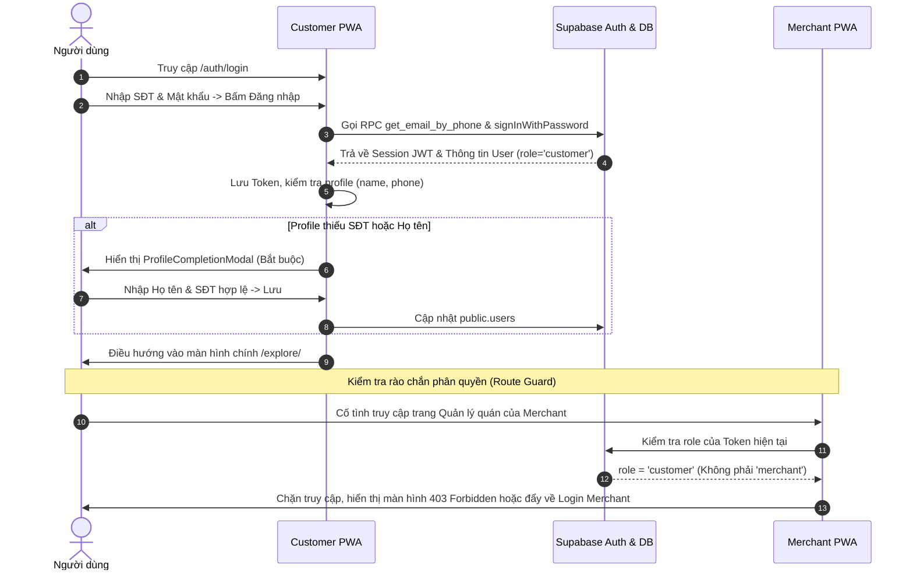

# ĐẶC TẢ KỊCH BẢN KIỂM THỬ: 01 — XÁC THỰC, PHÂN QUYỀN & BẢO MẬT (AUTH & SECURITY)

> **Mã đặc tả:** `SRS-01-AUTH-SEC`  
> **Phạm vi:** Đăng nhập (Email, Phone, Google OAuth), tạo profile người dùng, phân quyền vai trò (Customer / Merchant), cô lập cửa hàng 1:1, kiểm soát Row-Level Security (RLS) và bảo vệ thông tin nhạy cảm.  
> **Mã nguồn liên quan:** `apps/customer/src/services/auth.service.ts`, `apps/merchant/src/services/auth.service.ts`, `tests/auth-backend.test.ts`, `supabase/migrations/0009`–`0041`.

---

## 1. Mục 1 — Ca kiểm thử chấp nhận (UAT - Acceptance Test Cases)

### `TC-1.1` — Đăng nhập tài khoản Khách hàng bằng Số điện thoại & Mật khẩu
* **Mô tả:** Khách hàng sử dụng số điện thoại Việt Nam đã đăng ký để đăng nhập vào PWA Customer.
* **Given (Điều kiện ban đầu):**
  * Khách hàng đã có tài khoản với số điện thoại `0987654321`, mật khẩu `MatKhau@123`, họ tên `Nguyễn Văn An`.
  * Khách hàng đang ở màn hình đăng nhập của Customer PWA (`/auth/login`).
* **When (Hành động thực hiện):**
  1. Nhập số điện thoại `0987654321`.
  2. Nhập mật khẩu `MatKhau@123`.
  3. Bấm nút *"Đăng nhập"*.
* **Then (Kết quả mong đợi):**
  * Hệ thống xác thực thành công, hiển thị thông báo toast: *"Đăng nhập thành công"*.
  * Ứng dụng lưu phiên đăng nhập (JWT token trong LocalStorage/Cookies).
  * Chuyển hướng người dùng về trang khám phá `/explore/`.
  * Header hiển thị tên khách hàng *"Nguyễn Văn An"*.

### `TC-1.2` — Bắt buộc hoàn thiện hồ sơ khi đăng nhập lần đầu qua Google OAuth
* **Mô tả:** Người dùng mới đăng nhập qua Google OAuth chưa có số điện thoại hợp lệ phải hoàn thiện thông tin trước khi đặt món.
* **Given (Điều kiện ban đầu):**
  * Khách hàng dùng tài khoản Google mới `user.test@gmail.com` lần đầu đăng nhập.
* **When (Hành động thực hiện):**
  1. Bấm nút *"Tiếp tục với Google"* tại màn hình đăng nhập.
  2. Hoàn tất xác thực Google OAuth PKCE.
* **Then (Kết quả mong đợi):**
  * Trigger `handle_new_user` tự động tạo bản ghi trong bảng `public.users` với `role = 'customer'`.
  * Do trường `phone` đang `null`, PWA hiển thị modal cưỡng chế: *"Hoàn thiện hồ sơ cá nhân"*.
  * Không cho phép tắt modal ra ngoài cho đến khi nhập đúng họ tên và số điện thoại 10 số hợp lệ (ví dụ: `0912345678`).

### `TC-1.3` — Cô lập quyền Merchant: Không cho phép truy cập cửa hàng của người khác
* **Mô tả:** Một Merchant đã đăng nhập chỉ có quyền xem và quản lý cửa hàng thuộc quyền sở hữu của mình (`stores.owner_user_id = auth.uid()`).
* **Given (Điều kiện ban đầu):**
  * Merchant A sở hữu Cửa hàng X (ID: `store-001`).
  * Merchant B sở hữu Cửa hàng Y (ID: `store-002`).
  * Merchant A đang đăng nhập trên Merchant PWA.
* **When (Hành động thực hiện):**
  * Merchant A cố tình can thiệp đường dẫn hoặc gửi request truy xuất thông tin doanh thu của Cửa hàng Y (`store-002`).
* **Then (Kết quả mong đợi):**
  * Chính sách Supabase RLS ngăn chặn truy vấn.
  * Hệ thống trả về danh sách rỗng hoặc lỗi quyền truy cập, tuyệt đối không lộ dữ liệu đơn hàng và doanh thu của Cửa hàng Y.

---

## 2. Mục 2 — Kiểm thử API & Database RPC (`API-nn`)

| Mã Test | Phương thức & Endpoint / RPC | Dữ liệu đầu vào (Payload) | Điều kiện kiểm thử | Kết quả mong đợi (Status & DB Mutation) |
| :--- | :--- | :--- | :--- | :--- |
| `API-01` | **RPC** `get_email_by_phone` | `{"p_phone": "0987654321"}` | Số điện thoại đã tồn tại trong bảng `users` | **200 OK**, trả về chuỗi email ẩn dạng mask hoặc email thật nội bộ để thực hiện login Supabase Auth. |
| `API-02` | **RPC** `get_email_by_phone` | `{"p_phone": "0999999999"}` | Số điện thoại chưa từng đăng ký | **200 OK**, trả về `null` hoặc báo lỗi nghiệp vụ `PHONE_NOT_FOUND`. Không crash hệ thống. |
| `API-03` | **RPC** `delete_user_account` | `{"p_user_id": "<auth.uid>"}` | Người dùng tự yêu cầu xóa tài khoản cá nhân | **200 OK**, đánh dấu `deleted_at = now()` hoặc cascade xóa dữ liệu cá nhân theo chính sách bảo mật dữ liệu PII. |
| `API-04` | **POST** Supabase Auth `signInWithPassword` | `{"email": "store.hanoi@gsf.vn", "password": "WrongPassword!"}` | Đăng nhập Merchant với mật khẩu sai | **400 Bad Request**, mã lỗi `invalid_credentials`. Số lần đăng nhập sai tăng lên để kích hoạt rate-limit. |

---

## 3. Mục 3 — Kiểm thử Bảo mật & RLS (`SEC-nn`)

### `SEC-01` — Kiểm tra bảo vệ Row-Level Security (RLS) trên bảng `orders`
* **Given:** Khách hàng C1 có đơn hàng `order_c1_id`. Khách hàng C2 đăng nhập với tài khoản riêng.
* **When:** C2 dùng Supabase Client thực thi truy vấn trực tiếp:
  ```javascript
  const { data } = await supabase.from('orders').select('*').eq('id', 'order_c1_id');
  ```
* **Then:** 
  * RLS Policy `orders_customer_read` chỉ cho phép `customer_id = auth.uid()`.
  * Mảng `data` trả về là rỗng `[]`, không có dữ liệu đơn hàng của C1.

### `SEC-02` — Bảo vệ mã nhận hàng bí mật `pickup_token`
* **Given:** Đơn hàng được tạo thành công với một mã UUID bí mật `pickup_token` dùng để nhận món.
* **When:** Khách hàng chưa thanh toán (`status = 'pending_payment'`), hoặc người dùng lạ truy vấn trường `pickup_token`.
* **Then:**
  * Client thông thường không đọc được `pickup_token` trước khi đơn hàng chuyển sang trạng thái `ready_for_pickup`.
  * Sau khi đơn hàng hoàn tất (`completed`) hoặc bị hủy (`cancelled`), trigger tự động xóa/vô hiệu hóa `pickup_token` để chống tái sử dụng mã cũ để lấy đồ ăn lần 2.

### `SEC-03` — Ngăn chặn Merchant chỉnh sửa trái phép giá túi đồ ăn của cửa hàng khác
* **Given:** Merchant B gửi lệnh `UPDATE surprise_bags SET discount_price = 1000 WHERE store_id = 'store_A'`.
* **When:** Thực thi lệnh update với Token của Merchant B.
* **Then:**
  * Supabase RLS trên bảng `surprise_bags` yêu cầu `store_id IN (SELECT id FROM stores WHERE owner_user_id = auth.uid())`.
  * Lệnh cập nhật bị chặn, số dòng ảnh hưởng bằng 0 (`0 rows updated`).

---

## 4. Mục 4 — Kiểm thử Giao diện & Component UI (`UI-nn`)

### `UI-01` — Thành phần `LoginForm` (Form Đăng nhập)
Kiểm thử 4 trạng thái bắt buộc:
1. **`Loading` State:** Khi người dùng bấm nút *"Đăng nhập"*, nút chuyển sang trạng thái disabled, icon Spinner xoay, nhãn đổi thành *"Đang đăng nhập..."*. Ngăn chặn người dùng bấm nhiều lần.
2. **`Success` State:** Đăng nhập thành công, xuất hiện toast thông báo màu xanh, giao diện mờ dần (fade out) để chuyển trang mượt mà.
3. **`Error` State:** Nhập sai mật khẩu, hệ thống hiển thị thông báo viền đỏ bên dưới ô input: *"Số điện thoại hoặc mật khẩu không chính xác"*, focus lại vào ô mật khẩu.
4. **`Empty` State:** Để trống các ô input mà bấm submit: hiển thị lỗi validate nội bộ ngay tại client (*"Vui lòng nhập số điện thoại"*, *"Vui lòng nhập mật khẩu"*).

### `UI-02` — Thành phần `PhoneInputField` (Ô nhập số điện thoại)
* **Kiểm thử định dạng:** Tự động lọc các ký tự chữ, chỉ cho nhập số. Giới hạn tối đa đúng 10 chữ số.
* **Validation đầu số Việt Nam:** Báo lỗi nếu đầu số không thuộc các nhà mạng Việt Nam hợp lệ (phải bắt đầu bằng `03`, `05`, `07`, `08`, `09`).

### `UI-03` — Thành phần `StoreStatusToggle` trên Merchant PWA
* **Mô tả:** Nút gạt chuyển đổi trạng thái cửa hàng *"Đang mở cửa"* / *"Tạm đóng cửa"*.
* **Hành vi UI:**
  * Khi gạt toggle, hiển thị ngay hiệu ứng chuyển động gạt kèm trạng thái loading mờ (Optimistic UI).
  * Khi backend xác nhận thành công: Badge chuyển từ màu xanh (*"Đang mở cửa"*) sang màu xám (*"Đóng cửa"*).
  * Nếu mất kết nối mạng: Bật thông báo lỗi và tự động gạt nút về vị trí ban đầu.

---

## 5. Mục 5 — Kịch bản E2E Frontend Flow & Xác thực phân quyền (`E2E-nn`)

### `E2E-01` — Luồng Đăng nhập, Hoàn thiện hồ sơ & Điều hướng phân quyền



**Bảng chi tiết các bước kiểm thử E2E-01:**

| Bước | Ứng dụng | Hành động của người dùng | Phản hồi của hệ thống | Trạng thái hiển thị |
| :---: | :--- | :--- | :--- | :--- |
| **1** | Customer PWA | Truy cập trang chủ `/explore/` khi chưa đăng nhập. | Header hiển thị nút *"Đăng nhập / Đăng ký"*. Khách vẫn có thể xem danh sách túi đồ ăn. | Chế độ khách vãng lai (Guest). |
| **2** | Customer PWA | Bấm chọn 1 túi đồ ăn và bấm *"Thêm vào giỏ hàng"*. | Modal chặn lại yêu cầu: *"Vui lòng đăng nhập để tiếp tục"*. | Popup Đăng nhập hiển thị. |
| **3** | Customer PWA | Nhập SĐT `0987654321` và Mật khẩu chính xác. | Hệ thống xác thực, cấp phát Token, lưu vào LocalStorage. | Chuyển sang trạng thái đã đăng nhập, giỏ hàng cập nhật món đã chọn. |
| **4** | Merchant PWA | Dùng trình duyệt đó mở tab Merchant PWA (`/merchant/dashboard`). | Hook `useAuth` kiểm tra thấy `role === 'customer'`. | Chặn truy cập, hiển thị thông báo: *"Tài khoản này không có quyền quản lý cửa hàng"*. |
| **5** | Customer PWA | Khách bấm *"Đăng xuất"* trong cài đặt tài khoản. | Xóa sạch Token trong LocalStorage, hủy Realtime subscription. | Giao diện quay trở lại trạng thái Guest ban đầu. |
