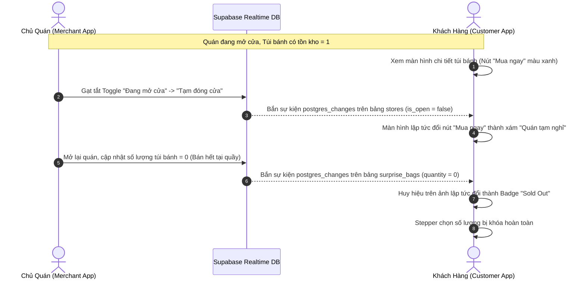

# ĐẶC TẢ KỊCH BẢN KIỂM THỬ: 02 — VÒNG ĐỜI TÚI ĐỒ ĂN & THỜI GIAN MỞ BÁN (BAG TIMING & LIFECYCLE)

> **Mã đặc tả:** `SRS-02-BAG-LIFECYCLE`  
> **Phạm vi:** Phân biệt 2 loại túi (`daily` và `shelf_life`), kiểm soát khung giờ nhận món (`pickup_start` - `pickup_end`), tự động chuyển trạng thái Hết món (`sold_out`), tìm kiếm PostGIS theo định vị Mapbox và đồng bộ Realtime số lượng tồn kho.  
> **Mã nguồn liên quan:** `tests/bagTiming.test.ts`, `tests/mapbox.test.ts`, `apps/customer/src/features/search/`, `supabase/migrations/0032_dry_food_inventory_lifecycle.sql`, `0036_expand_merchants_and_yindii_bags.sql`.

---

## 1. Mục 1 — Ca kiểm thử chấp nhận (UAT - Acceptance Test Cases)

### `TC-2.1` — Túi đồ ăn trong ngày (`daily`): Chỉ được phép đặt trong khung giờ nhận hàng
* **Mô tả:** Khách hàng chỉ có thể mua Túi bất ngờ trong ngày nếu thời điểm đặt nằm trong khung giờ quy định của quán.
* **Given (Điều kiện ban đầu):**
  * Quán *"Bready Bakery Hoàng Quốc Việt"* có Túi bánh tươi trong ngày (`bag_type = 'daily'`).
  * Khung giờ mở bán và nhận món: Từ `18:00:00` đến `20:30:00` (Múi giờ `Asia/Ho_Chi_Minh`).
  * Số lượng tồn kho hiện tại: `5` túi.
* **When (Hành động thực hiện):**
  * **Trường hợp A (Trong giờ):** Khách truy cập lúc `18:45` và bấm *"Thêm vào giỏ hàng"*.
  * **Trường hợp B (Ngoài giờ):** Khách truy cập lúc `21:00` và cố gắng bấm *"Đặt món"*.
* **Then (Kết quả mong đợi):**
  * **Trường hợp A:** Hệ thống cho phép thêm túi vào giỏ hàng, hiển thị đồng hồ đếm ngược: *"Thời gian lấy món còn lại: 1 giờ 45 phút"*.
  * **Trường hợp B:** Nút đặt hàng bị vô hiệu hóa (disabled), hiển thị nhãn: *"Đã hết khung giờ lấy món hôm nay"*. Khách không thể tiến hành checkout.

### `TC-2.2` — Túi đồ khô có hạn sử dụng (`shelf_life`): Đặt món không phụ thuộc giờ trong ngày
* **Mô tả:** Với túi đồ khô hoặc bánh đóng gói (`shelf_life`), khách hàng có thể đặt bất cứ lúc nào miễn là ngày hết hạn lớn hơn hoặc bằng ngày hiện tại.
* **Given (Điều kiện ban đầu):**
  * Quán đăng bán Túi hạt sấy giòn (`bag_type = 'shelf_life'`).
  * Ngày hết hạn của lô hàng (`expiry_date`): `2026-11-20`.
  * Thời điểm khách đặt hàng: `23:30:00` ngày `2026-11-12`.
* **When (Hành động thực hiện):**
  * Khách hàng bấm thêm túi vào giỏ và hoàn tất đặt hàng.
* **Then (Kết quả mong đợi):**
  * Hệ thống cho phép đặt bình thường, không chặn theo khung giờ trong ngày `[pickup_start, pickup_end]`.
  * Đơn hàng ghi nhận hạn lấy hàng theo ngày cụ thể.

### `TC-2.3` — Tự động chuyển trạng thái "Hết món" (Sold Out) khi số lượng về 0
* **Mô tả:** Khi khách hàng mua hết số lượng túi cuối cùng, hệ thống tự động khóa túi, ngăn các khách khác mua tiếp.
* **Given (Điều kiện ban đầu):**
  * Túi Cơm Bento Giải Cứu chỉ còn đúng `1` phần trong kho (`quantity = 1`).
  * Hai khách hàng C1 và C2 cùng xem túi này cùng một lúc.
* **When (Hành động thực hiện):**
  * Khách C1 bấm thanh toán thành công suất cuối cùng trước.
* **Then (Kết quả mong đợi):**
  * Database trigger `auto_deactivate_surprise_bag` lập tức kích hoạt: cập nhật `quantity = 0`, `is_available = false`, `status = 'sold_out'`.
  * Màn hình của khách C2 nhận sự kiện Supabase Realtime: Nút bấm trên giao diện lập tức chuyển xám thành *"Hết món"*, số lượng stepper bị khóa về 0.

---

## 2. Mục 2 — Kiểm thử API & Database RPC (`API-nn`)

| Mã Test | Phương thức & Endpoint / RPC | Dữ liệu đầu vào (Payload) | Điều kiện kiểm thử | Kết quả mong đợi (Status & DB Mutation) |
| :--- | :--- | :--- | :--- | :--- |
| `API-201` | **RPC** `list_stores_nearby` | `{"p_lat": 21.0285, "p_lng": 105.8542, "p_radius_meters": 5000}` | Tọa độ trung tâm Hà Nội, bán kính 5km | **200 OK**, trả về danh sách các cửa hàng đối tác trong bán kính 5km, sắp xếp theo khoảng cách tăng dần qua PostGIS. |
| `API-202` | **RPC** `list_bags_nearby` | `{"p_lat": 21.0285, "p_lng": 105.8542, "p_category": "bakery"}` | Tìm túi giải cứu danh mục bánh mì/tiệm bánh | **200 OK**, trả về mảng các túi thuộc `bag_category = 'bakery'`, chỉ gồm các túi còn `is_available = true` và `quantity > 0`. |
| `API-203` | **RPC** `cron_daily_bag_cycle` | Không có (Trigger định kỳ ban đêm) | Chạy định kỳ lúc 00:00 hàng ngày | **200 OK**, tự động làm mới số lượng túi `daily` về giá trị `daily_quota` ban đầu cho ngày mới. |
| `API-204` | **PATCH** `/api/merchant/bags/:id` | `{"quantity": 0}` | Merchant chỉnh số lượng túi về 0 thủ công | **200 OK**, trường `status` trong DB tự động chuyển thành `'sold_out'` và `is_available = false`. |

---

## 3. Mục 3 — Kiểm thử Bảo mật & Toàn vẹn dữ liệu (`SEC-nn`)

### `SEC-201` — Chống tấn công Race Condition mua quá số lượng tồn kho (Overselling)
* **Given:** Một túi bất ngờ chỉ còn đúng `1` sản phẩm duy nhất trong kho.
* **When:** Có `5` request đặt hàng đồng thời gửi lên trong cùng một mili-giây.
* **Then:**
  * Stored Procedure `create_order_transaction` sử dụng khóa hàng (`SELECT FOR UPDATE`) hoặc kiểm tra atomic `quantity >= requested_quantity`.
  * Chỉ duy nhất **1 request thành công**, 4 request còn lại bị từ chối với lỗi nghiệp vụ `OUT_OF_STOCK` (hoặc mã lỗi tương đương).
  * Số lượng tồn kho sau kiểm thử không bao giờ được âm (`quantity >= 0`).

### `SEC-202` — Kiểm tra tính toàn vẹn của tọa độ vị trí (PostGIS Validation)
* **Given:** Merchant cập nhật tọa độ vị trí cửa hàng qua API.
* **When:** Merchant cố tình gửi tọa độ kinh độ/vĩ độ không hợp lệ (Ví dụ: `latitude = 120.5` hoặc `longitude = 200.0`).
* **Then:**
  * Ràng buộc kiểm tra của PostgreSQL PostGIS từ chối câu lệnh với lỗi `Coordinate out of bounds`.
  * Tránh làm sai lệch dữ liệu tính toán khoảng cách của toàn hệ thống.

---

## 4. Mục 4 — Kiểm thử Giao diện & Component UI (`UI-nn`)

### `UI-201` — Thành phần `QuantityStepper` (Bộ chọn số lượng món)
Kiểm thử 4 trạng thái cốt lõi:
1. **`Loading` State:** Khi đang chờ xác nhận tồn kho từ mạng, nút bấm dấu `+` và `-` tạm thời disabled, hiển thị hiệu ứng skeleton mờ.
2. **`Success` State:** Khách bấm `+`, số lượng tăng lên từ `1` lên `2`, hiển thị tổng tiền tự động tính tương ứng.
3. **`Error` State (Đạt ngưỡng tối đa):** Khi số lượng chạm bằng `quantity` tồn kho (ví dụ quán chỉ còn 2 túi):
   * Nút `+` bị làm mờ (disabled).
   * Hiển thị thông báo nhỏ màu cam: *"Chỉ còn 2 túi trong kho"*.
4. **`Empty` / Disabled State:** Khi túi đã bán hết (`sold_out`), cả bộ Stepper bị ẩn và thay thế bằng nút xám *"Hết món"*.

### `UI-202` — Thành phần `PickupCountdownBadge` (Huy hiệu đếm ngược giờ lấy món)
* **Khung giờ hợp lệ:** Hiển thị màu xanh lá: `Lấy món từ 18:00 - 20:30`.
* **Sắp hết giờ (< 30 phút):** Tự động chuyển màu đỏ cảnh báo kèm icon đồng hồ cát: `Còn 25 phút để nhận món`.
* **Đã hết giờ:** Chuyển màu xám: `Đã kết thúc khung giờ nhận`.

### `UI-203` — Thành phần `SurpriseBagCardSkeleton` (Trạng thái Loading danh sách)
* Khi khách hàng đổi vị trí hoặc chuyển bộ lọc danh mục:
  * Không để màn hình trắng.
  * Hiển thị ít nhất 4 thẻ Skeleton card với hiệu ứng sóng (shimmer wave) mô phỏng ảnh, tiêu đề và giá tiền.

---

## 5. Mục 5 — Kịch bản E2E & Đồng bộ Realtime Tồn kho 2 App (`E2E-nn`)

### `E2E-02` — Quán điều chỉnh tồn kho / Đóng mở quán $\leftrightarrow$ Khách hàng cập nhật tức thì

Kịch bản mô phỏng tương tác song song thời gian thực giữa màn hình Quán (`Merchant PWA`) và màn hình Khách (`Customer PWA`):

**Bảng chi tiết các bước chuyển dịch trạng thái Realtime E2E-02:**

| Bước | Hành động trên Merchant PWA | Hành động trên Customer PWA | Trạng thái đồng bộ Backend | Kết quả quan sát được trên giao diện |
| :---: | :--- | :--- | :--- | :--- |
| **1** | Chủ quán vào trang quản lý túi: Sửa số lượng túi *"Bánh mì mè đen"* từ `5` xuống còn `1`. | Khách hàng đang mở màn hình xem chi tiết túi bánh mì mè đen. | Cập nhật `surprise_bags.quantity = 1`. | Stepper bên app khách tự động giảm giới hạn tối đa xuống `1`. Không cho khách chọn `2`. |
| **2** | Quán phát sinh việc bận đột xuất: Gạt nút đóng cửa hàng (`is_open = false`). | Khách hàng đang ở trang danh sách túi của quán đó. | Bảng `stores` cập nhật `is_open = false`. | Danh sách túi bên khách ngay lập tức phủ lớp màng mờ, hiển thị nhãn: *"Quán hiện đang đóng cửa"*. Nút đặt hàng bị khóa. |
| **3** | Quán mở lại cửa hàng (`is_open = true`). | Khách vẫn đang xem màn hình đó. | Bảng `stores` cập nhật `is_open = true`. | Lớp màng mờ tự động biến mất, nút đặt hàng xanh trở lại mà khách **không cần phải bấm F5 tải lại trang**. |
