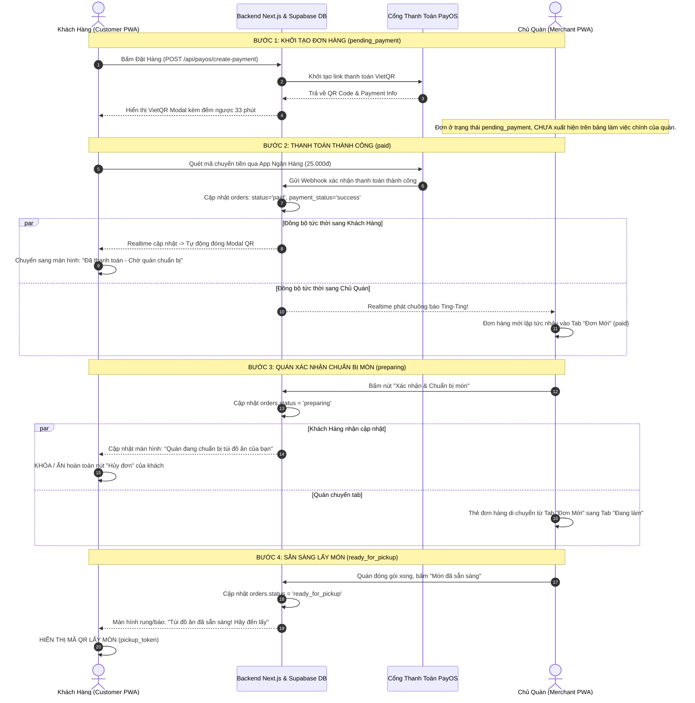

# ĐẶC TẢ KỊCH BẢN KIỂM THỬ: 03 — ĐẶT HÀNG & THANH TOÁN VIETQR / VOUCHER 0Đ (ORDER & PAYMENT)

> **Mã đặc tả:** `SRS-03-ORDER-PAYMENT`  
> **Phạm vi:** Đặt hàng atomic qua PostgreSQL RPC, cấm thanh toán tiền mặt, tích hợp cổng thanh toán PayOS VietQR, luồng rẽ nhánh Voucher 0đ (`TMU2026`), xử lý Webhook bất đồng bộ, cơ chế đếm ngược 33 phút và tự động hủy đơn hết hạn.  
> **Mã nguồn liên quan:** `apps/web/app/api/payos/*`, `apps/customer/src/features/checkout/`, `supabase/migrations/0026_safe_payment_buffer_and_auto_refund.sql`, `0040_zero_vnd_order_flow.sql`, `0041_add_hidden_voucher_tmu2026.sql`, `docs/adr/ADR-004-payos-vietqr-and-zero-vnd-voucher-flow.md`.

---

## 1. Mục 1 — Ca kiểm thử chấp nhận (UAT - Acceptance Test Cases)

### `TC-3.1` — Đặt hàng thành công qua cổng thanh toán PayOS VietQR
* **Mô tả:** Khách hàng thanh toán đơn hàng có giá trị tiền dương bằng cách quét mã VietQR tự động.
* **Given (Điều kiện ban đầu):**
  * Khách hàng đã chọn 1 Túi Bánh Mì Cứu Trợ (giá gốc: `50.000đ`, giá cứu trợ: `25.000đ`).
  * Khách hàng đã đăng nhập và đang ở màn hình Thanh toán (`/checkout`).
* **When (Hành động thực hiện):**
  1. Kiểm tra thông tin người nhận: Họ tên `Trần Thị Mai`, SĐT `0988776655`.
  2. Chọn phương thức thanh toán: `Chuyển khoản VietQR qua PayOS`.
  3. Bấm nút *"Tiến hành thanh toán"*.
* **Then (Kết quả mong đợi):**
  * Hệ thống gọi RPC tạo đơn hàng và chuyển sang màn hình mã QR PayOS.
  * Hiển thị mã VietQR tiêu chuẩn (kèm Logo Napas 247).
  * Hiển thị chính xác số tiền phải trả: `25.000 đ`.
  * Hiển thị số tài khoản ngân hàng thụ hưởng và nội dung chuyển khoản tự động (chứa mã đơn hàng duy nhất).
  * Đồng hồ đếm ngược hiển thị `33:00` và bắt đầu đếm lùi từng giây.

### `TC-3.2` — Thanh toán nhanh 0đ với Voucher khuyến mãi 100% (`TMU2026`)
* **Mô tả:** Khách hàng áp dụng mã voucher giảm giá 100% (ví dụ mã tài trợ sự kiện `TMU2026`), đơn hàng có giá trị `final_amount = 0đ` phải được duyệt thành công ngay lập tức mà không cần tạo liên kết PayOS.
* **Given (Điều kiện ban đầu):**
  * Giỏ hàng có 1 suất ăn trị giá `30.000đ`.
  * Khách hàng chưa từng sử dụng mã `TMU2026`.
* **When (Hành động thực hiện):**
  1. Tại ô *"Mã giảm giá"*, nhập chuỗi ký tự: `TMU2026`.
  2. Bấm nút *"Áp dụng"*.
  3. Sau khi số tiền thanh toán giảm về `0 đ`, bấm *"Xác nhận đặt hàng"*.
* **Then (Kết quả mong đợi):**
  * Hệ thống phát hiện `final_amount <= 0`.
  * Bỏ qua hoàn toàn việc gọi sang API PayOS.
  * Stored Procedure `create_order_transaction` tự động cập nhật ngay trạng thái: `status = 'paid'`, `payment_status = 'success'`.
  * Màn hình PWA lập tức chuyển sang trạng thái: *"Đặt hàng thành công - Quán đã nhận đơn"*, sẵn sàng chờ lấy món.
  * Tăng số lượt sử dụng voucher trong bảng `vouchers`.

### `TC-3.3` — Tự động hủy đơn hàng và hoàn lại tồn kho khi hết hạn 33 phút (TTL Expiration)
* **Mô tả:** Đơn hàng chưa được chuyển khoản quá 33 phút sẽ tự động hết hạn, nhả lại suất ăn cho cộng đồng.
* **Given (Điều kiện ban đầu):**
  * Đơn hàng `GSF-999` được tạo lúc `14:00`, trạng thái `pending_payment`, số lượng đặt `2` túi.
  * Tồn kho của quán giảm từ `10` xuống `8`.
* **When (Hành động thực hiện):**
  * Đến `14:33:01` (sau 33 phút), khách hàng vẫn chưa chuyển khoản.
  * Hàm dọn dẹp `expire_unpaid_orders` được kích hoạt (qua pg_cron hoặc lazy cleanup).
* **Then (Kết quả mong đợi):**
  * Trạng thái đơn hàng đổi thành: `status = 'expired'`.
  * Số lượng tồn kho của túi đồ ăn được hoàn trả cộng lại: `8 + 2 = 10`.
  * Nếu đơn có áp voucher, voucher được phục hồi quyền sử dụng cho khách.
  * Token thanh toán cũ bị vô hiệu hóa.

---

## 2. Mục 2 — Kiểm thử API & Database RPC (`API-nn`)

| Mã Test | Phương thức & Endpoint / RPC | Dữ liệu đầu vào (Payload) | Điều kiện kiểm thử | Kết quả mong đợi (Status & DB Mutation) |
| :--- | :--- | :--- | :--- | :--- |
| `API-301` | **RPC** `create_order_transaction` | `{"p_items": [{"bag_id": "...", "quantity": 1}], "p_payment_method": "cash"}` | Cố tình chọn phương thức trả tiền mặt | **Lỗi 400 / Exception**, trả về mã lỗi `CASH_PAYMENT_NOT_SUPPORTED`. Giao dịch Rollback toàn bộ. |
| `API-302` | **POST** `/api/payos/create-payment` | `{"orderId": "<uuid>", "amount": 25000, "description": "GSF Don Hang 123"}` | Đơn hàng hợp lệ, chưa thanh toán | **200 OK**, trả về JSON gồm: `{checkoutUrl, qrCode, paymentLinkId, orderCode}`. Cập nhật `payment_order_code` vào bảng `orders`. |
| `API-303` | **POST** `/api/payos/webhook` | Payload PayOS gửi sang kèm chữ ký `signature` hợp lệ trong header | Ngân hàng báo khách đã chuyển tiền đủ | **200 OK**, xác thực HMAC SHA256 thành công. Cập nhật `orders.status = 'paid'`, `orders.payment_status = 'success'`, `paid_at = now()`. |
| `API-304` | **POST** `/api/payos/webhook` | Payload PayOS nhưng chữ ký `signature` bị giả mạo | Kẻ gian tấn công giả lập webhook thanh toán | **401 Unauthorized** hoặc **400 Bad Request**, từ chối cập nhật trạng thái đơn hàng. |
| `API-305` | **GET** `/api/payos/check-status/:orderCode` | `orderCode = 1718293021` | Trường hợp Webhook bị nghẽn mạng, Client chủ động Polling | **200 OK**, đồng bộ trực tiếp trạng thái từ PayOS Gateway về cơ sở dữ liệu Supabase. |

---

## 3. Mục 3 — Kiểm thử Bảo mật & Toàn vẹn giao dịch (`SEC-nn`)

### `SEC-301` — Chống tấn công giả mạo tổng tiền thanh toán từ Client (Client-Side Price Tampering)
* **Given:** Khách hàng đặt túi đồ ăn có giá niêm yết trong DB là `50.000đ`.
* **When:** Kẻ tấn công can thiệp vào request HTTP, sửa payload thành:
  ```json
  { "bag_id": "bag-01", "quantity": 1, "p_final_amount": 1000 }
  ```
* **Then:**
  * Backend RPC tính toán lại giá trị thực tế dựa trên bảng `surprise_bags` và bảng `vouchers`.
  * Nếu phát hiện chênh lệch: Hủy bỏ giao dịch ngay lập tức với lỗi `INVALID_PAYMENT_AMOUNT`. Không tạo đơn hàng giả mạo giá rẻ.

### `SEC-302` — Chống áp dụng mã Voucher lặp lại nhiều lần (Voucher Reuse Exploit)
* **Given:** Khách hàng đã dùng mã `TMU2026` đặt thành công 1 đơn hàng trước đó.
* **When:** Khách hàng cố gắng dùng lại mã này lần thứ 2 trên cùng một tài khoản.
* **Then:**
  * RPC kiểm tra bảng `orders` xem khách hàng này đã có đơn hàng nào ở trạng thái `paid` hoặc `completed` sử dụng mã đó chưa.
  * Trả về lỗi: *"Bạn đã sử dụng mã giảm giá này rồi"*. Chặn đứng hành vi trục lợi khuyến mãi.

---

## 4. Mục 4 — Kiểm thử Giao diện & Component UI (`UI-nn`)

### `UI-301` — Thành phần `PayOSVietQRModal` (Popup hiển thị mã QR thanh toán)
Kiểm thử 4 trạng thái bắt buộc:
1. **`Loading` State:** Khi vừa bấm đặt hàng, hiển thị khung ảnh QR màu xám kèm Spinner chính giữa và dòng chữ: *"Đang tạo mã VietQR bảo mật..."*.
2. **`Success` (Ready) State:** Ảnh QR hiển thị rõ nét, kèm thông tin Ngân hàng, Tên chủ tài khoản, Số tiền in đậm, và nút *"Sao chép số tài khoản"* (bấm vào báo Toast *"Đã sao chép"*).
3. **`Polling / Verifying` State:** Sau khi khách quét mã trên App ngân hàng, hệ thống nhận được tín hiệu sẽ đổi nhãn sang: *"Đang xác thực giao dịch, vui lòng chờ trong giây lát..."*.
4. **`Error / Timeout` State:** Khi đồng hồ 33 phút đếm về `00:00`:
   * Mã QR bị làm mờ và phủ biểu tượng ổ khóa màu xám.
   * Hiển thị dòng chữ: *"Mã thanh toán đã hết hạn"*.
   * Xuất hiện nút *"Thử lại"* hoặc *"Về trang chủ"*.

### `UI-302` — Thành phần `CheckoutSubmitButton` (Nút xác nhận đặt hàng)
* **Cơ chế chống bấm đúp (Debounce & Idempotency):**
  * Ngay khi khách bấm vào nút *"Thanh toán"*, nút lập tức bị `disabled`.
  * Hiệu ứng icon xoay tròn ngăn chặn khách bấm liên tiếp 2-3 lần do mạng chậm, loại trừ hoàn toàn việc tạo 2 đơn hàng trùng nhau.

### `UI-303` — Thành phần `VoucherInputBox` (Khung nhập mã giảm giá)
* **Nhập mã hợp lệ:** Bấm *"Áp dụng"* $\rightarrow$ Nút xoay 0.5s $\rightarrow$ Hiện nhãn xanh lá: *"Áp dụng thành công (-100%)"*, dòng tổng tiền bị gạch ngang và đổi thành `0 đ`.
* **Nhập mã sai / hết hạn:** Hiện viền đỏ quanh ô input kèm thông báo lỗi: *"Mã giảm giá không tồn tại hoặc đã hết lượt dùng"*.

---

## 5. Mục 5 — Kịch bản E2E & Chuyển trạng thái song song trên 2 App (`E2E-nn`)

### `E2E-03` — Luồng Toàn Trình: Khách Đặt Hàng & Thanh Toán VietQR $\rightarrow$ Chuyển Trạng Thái Trên Cả 2 Ứng Dụng

Kịch bản này kiểm tra sự phối hợp đồng bộ thời gian thực giữa **Customer PWA** và **Merchant PWA** qua từng giây chuyển dịch trạng thái:



**Bảng ma trận kiểm tra hành vi chi tiết trên 2 ứng dụng:**

| Bước | Sự kiện kích hoạt | Trạng thái đơn (`status`) | Màn hình Customer PWA | Màn hình Merchant PWA | Dữ liệu kiểm tra trong Database |
| :---: | :--- | :---: | :--- | :--- | :--- |
| **B1** | Khách bấm nút *"Đặt hàng"* tại màn hình Checkout | `pending_payment` | Mở popup hiển thị mã VietQR, bộ đếm ngược `33:00` chạy lùi. | Đơn chưa hiện lên danh sách chính (hoặc chỉ nằm ở danh sách nháp). | `orders.status = 'pending_payment'`, `payment_status = 'pending'`, `orders.payos_qr_code IS NOT NULL`. Tồn kho túi bị tạm trừ `-1`. |
| **B2** | Khách quét mã chuyển tiền qua App Ngân hàng thành công | `paid` | **Tự động chuyển trang** sang màn hình chờ nhận món. Hiện thông báo: *"Thanh toán thành công"*. | **Chuông thông báo kêu to**. Một thẻ đơn hàng màu xanh xuất hiện trong cột *"Đơn mới nhận"*. | `orders.status = 'paid'`, `orders.payment_status = 'success'`, `paid_at = now()`. Tạo bản ghi trong `notifications` cho quán. |
| **B3** | Quán bấm *"Xác nhận & Chuẩn bị"* | `preparing` | Realtime đổi dòng trạng thái: *"Quán đang chuẩn bị món"*. **Nút "Hủy đơn hàng" bị ẩn đi**. | Thẻ đơn hàng chuyển sang cột *"Đang chuẩn bị"*. | `orders.status = 'preparing'`. Khách hàng gọi API hủy sẽ bị chặn với mã lỗi `CANNOT_CANCEL_PREPARING_ORDER`. |
| **B4** | Quán đóng hộp xong, bấm *"Đã chuẩn bị xong"* | `ready_for_pickup` | Màn hình khách nổi bật **Mã QR nhận hàng** (`pickup_token`) kèm hướng dẫn: *"Đưa mã này cho quán khi đến nhận"*. | Thẻ đơn hàng chuyển sang cột *"Chờ khách đến lấy"*. | `orders.status = 'ready_for_pickup'`, `pickup_token` hợp lệ sẵn sàng để đối soát. |

* **Kịch bản nhánh phụ B2-Alt (Áp mã voucher 0đ `TMU2026`):**
  * Tại Bước B1, khách áp mã voucher giảm 100% $\rightarrow$ Tổng tiền = `0 đ`.
  * Khách bấm đặt hàng $\rightarrow$ Bỏ qua bước chờ PayOS, hệ thống chuyển thẳng đơn hàng vào **Bước B2 (`paid`)** ngay lập tức trong vòng 300ms. Quán nhận chuông báo đơn mới ngay như đơn đã thanh toán.
