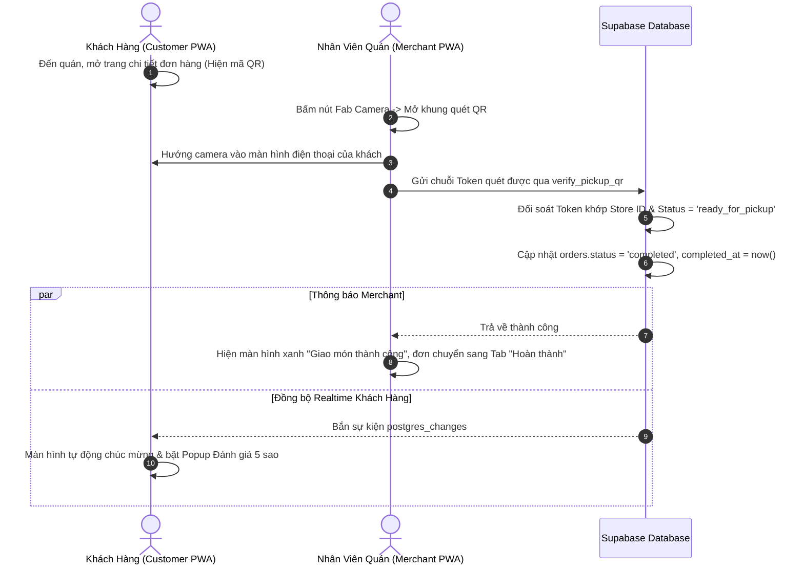

# ĐẶC TẢ KỊCH BẢN KIỂM THỬ: 04 — NHẬN MÓN, QUÉT QR & HOÀN TẤT ĐƠN HÀNG (PICKUP & FULFILLMENT)

> **Mã đặc tả:** `SRS-04-PICKUP-FULFILLMENT`  
> **Phạm vi:** Khách đưa mã QR nhận hàng, Quán dùng camera quét QR đối soát (`verify_pickup_qr`), hoàn tất đơn hàng, đánh giá trải nghiệm, quy trình hủy đơn & yêu cầu hoàn tiền (`refund_requests`), xử lý trường hợp khách không đến nhận (No-show policy).  
> **Mã nguồn liên quan:** `apps/merchant/src/components/orders/`, `apps/customer/src/features/orders/pages/`, `supabase/migrations/0029_cancel_order_with_refund_flow.sql`, `0032_dry_food_inventory_lifecycle.sql`.

---

## 1. Mục 1 — Ca kiểm thử chấp nhận (UAT - Acceptance Test Cases)

### `TC-4.1` — Quét mã QR nhận món thành công tại cửa hàng
* **Mô tả:** Khách hàng đến quán trong khung giờ quy định, xuất trình mã QR trên PWA. Nhân viên quán dùng camera quét mã để hoàn tất đơn hàng.
* **Given (Điều kiện ban đầu):**
  * Đơn hàng `GSF-2026-01` đang ở trạng thái `ready_for_pickup` (Sẵn sàng nhận món).
  * Khách hàng mở sẵn màn hình chi tiết đơn hàng hiển thị mã QR `pickup_token`.
  * Nhân viên mở Merchant PWA trên điện thoại, truy cập tính năng quét camera QR (`DraggableQRFab`).
* **When (Hành động thực hiện):**
  1. Nhân viên đưa camera quét qua mã QR trên màn hình điện thoại của khách.
  2. Ứng dụng đọc chuỗi token và gửi request gọi hàm `verify_pickup_qr`.
* **Then (Kết quả mong đợi):**
  * Merchant PWA phát âm thanh *"Tít!"* xác nhận, hiển thị dấu tích xanh to: *"Xác thực thành công - Đơn hàng hoàn tất"*.
  * Đơn hàng trong database chuyển sang `status = 'completed'`, `completed_at = now()`.
  * Màn hình của khách tự động chuyển sang trang Hoàn tất đơn hàng kèm thông điệp cảm ơn và mở modal đánh giá sao.

### `TC-4.2` — Khách hàng hủy đơn khi ở trạng thái `paid` & Nhập thông tin hoàn tiền
* **Mô tả:** Khách hàng đã thanh toán nhưng bận việc đột xuất trước khi quán bấm chuẩn bị, tiến hành hủy đơn và để lại số tài khoản hoàn tiền.
* **Given (Điều kiện ban đầu):**
  * Đơn hàng `GSF-2026-02` đã trả `35.000đ`, trạng thái là `paid` (Quán chưa bấm `preparing`).
* **When (Hành động thực hiện):**
  1. Khách bấm nút *"Hủy đơn hàng"*.
  2. Hệ thống hiển thị modal cảnh báo và yêu cầu nhập thông tin tài khoản ngân hàng để hoàn tiền.
  3. Khách nhập: Ngân hàng `MB Bank`, Số tài khoản `0987654321`, Tên chủ tài khoản `NGUYEN VAN AN`, Lý do `Có việc bận đột xuất`.
  4. Bấm *"Xác nhận hủy đơn"*.
* **Then (Kết quả mong đợi):**
  * Đơn hàng đổi thành: `status = 'cancelled'`, `payment_status = 'refund_pending'`.
  * Hệ thống tự động tạo 1 bản ghi mới trong bảng `refund_requests` lưu đầy đủ thông tin tài khoản ngân hàng.
  * Tồn kho của quán lập tức được cộng hoàn trả `+1` suất ăn.
  * Merchant PWA nhận thông báo: *"Đơn hàng GSF-2026-02 đã bị khách hủy"*.

### `TC-4.3` — Tự động xử lý trường hợp Khách không đến nhận (No-Show Policy)
* **Mô tả:** Đã quá 15 phút sau khung giờ nhận hàng quy định mà khách không đến lấy, hệ thống tự động xử lý đơn hết hạn để bảo vệ quyền lợi của cửa hàng.
* **Given (Điều kiện ban đầu):**
  * Túi đồ ăn có hạn lấy đến `20:00`. Đơn hàng ở trạng thái `ready_for_pickup`.
* **When (Hành động thực hiện):**
  * Đến `20:15:01` (quá 15 phút), khách hàng vẫn không xuất hiện quét mã.
  * Tiến trình `expire_noshow_orders` quét kiểm tra.
* **Then (Kết quả mong đợi):**
  * Trạng thái đơn đổi thành `status = 'expired'`.
  * Mã `pickup_token` bị hủy để tránh nhận đồ muộn.
  * Doanh thu của đơn hàng **vẫn được giữ nguyên tính cho cửa hàng** (bồi thường việc chuẩn bị nguyên liệu).
  * Đối với các túi đồ khô (`shelf_life`), số lượng tồn kho được hoàn lại kệ hàng.

---

## 2. Mục 2 — Kiểm thử API & Database RPC (`API-nn`)

| Mã Test | Phương thức & Endpoint / RPC | Dữ liệu đầu vào (Payload) | Điều kiện kiểm thử | Kết quả mong đợi (Status & DB Mutation) |
| :--- | :--- | :--- | :--- | :--- |
| `API-401` | **RPC** `verify_pickup_qr` | `{"p_pickup_token": "<uuid-token>", "p_store_id": "<store-uuid>"}` | Quán quét đúng mã token của đơn hàng thuộc quán mình | **200 OK**, trả về `{"success": true, "order_id": "..."}`. Cập nhật `status = 'completed'`, xóa mã token. |
| `API-402` | **RPC** `verify_pickup_qr` | `{"p_pickup_token": "<uuid-token>", "p_store_id": "<wrong-store>"}` | Quán A quét nhầm mã của đơn hàng đặt tại Quán B | **Lỗi 403 / Exception**, trả về mã lỗi `TOKEN_DOES_NOT_BELONG_TO_STORE`. Không đổi trạng thái đơn. |
| `API-403` | **RPC** `cancel_order_transaction` | `{"p_order_id": "...", "p_cancel_reason": "Hết nguyên liệu", "p_bank_info": {...}}` | Quán hoặc Khách thực hiện hủy đơn hợp lệ | **200 OK**, hoàn lại số lượng tồn kho của túi (`surprise_bags.quantity = quantity + n`). Nếu có thanh toán, chèn vào `refund_requests`. |
| `API-404` | **RPC** `cancel_order_transaction` | `{"p_order_id": "...", "p_cancel_reason": ""}` | Quán bấm hủy đơn nhưng để trống lý do hủy | **Lỗi 400**, báo lỗi `MERCHANT_CANCEL_REASON_REQUIRED`. Bắt buộc phải có lý do minh bạch cho khách hàng. |
| `API-405` | **POST** `/api/reviews` | `{"order_id": "...", "rating": 5, "comment": "Đồ ăn rất ngon, đóng gói sạch sẽ"}` | Khách gửi đánh giá sau khi hoàn tất đơn | **201 Created**, tạo bản ghi trong bảng `reviews`. Trigger tự động tính lại điểm trung bình sao `rating` của cửa hàng trong bảng `stores`. |

---

## 3. Mục 3 — Kiểm thử Bảo mật & Chống gian lận nhận hàng (`SEC-nn`)

### `SEC-401` — Chống sử dụng lại mã QR cũ (Replay Attack)
* **Given:** Khách hàng đã nhận món thành công lúc `19:00`, đơn hàng đã chuyển thành `completed`.
* **When:** Khách chụp lại màn hình mã QR cũ đó và đưa cho một nhân viên khác quét lại vào lúc `19:15`.
* **Then:**
  * Hàm `verify_pickup_qr` kiểm tra thấy trạng thái đơn đã là `completed` và trường `pickup_token` đã bị set `NULL`.
  * Hệ thống từ chối xác thực với thông báo đỏ: *"Mã nhận hàng này đã được sử dụng trước đó!"*. Ngăn chặn việc lấy đồ ăn 2 lần.

### `SEC-402` — Bảo vệ thông tin tài khoản ngân hàng trong `refund_requests`
* **Given:** Bảng `refund_requests` chứa thông tin nhạy cảm (Số tài khoản, Tên chủ tài khoản, Ngân hàng).
* **When:** Một khách hàng lạ hoặc Merchant cố tình truy vấn bảng `refund_requests`.
* **Then:**
  * Chính sách RLS chỉ cho phép:
    * Khách hàng sở hữu đơn hàng xem bản ghi hoàn tiền của chính mình.
    * Quản trị viên hệ thống (Admin) có thẩm quyền xử lý chuyển tiền hoàn.
  * Merchant tuyệt đối không được xem số tài khoản cá nhân của khách hàng để bảo vệ quyền riêng tư (PII).

---

## 4. Mục 4 — Kiểm thử Giao diện & Component UI (`UI-nn`)

### `UI-401` — Thành phần `QRScannerModal` trên Merchant PWA
Kiểm thử 4 trạng thái cốt lõi:
1. **`Loading` (Permission Request):** Vừa mở nút quét, hiển thị thông báo xin cấp quyền truy cập máy ảnh: *"Đang kết nối camera..."*.
2. **`Scanning` (Success Preview):** Màn hình hiển thị luồng video mượt mà kèm khung quét màu xanh lá căn giữa màn hình và dòng hướng dẫn: *"Căn chỉnh mã QR của khách vào trong khung"*.
3. **`Success Verified` State:** Khi phát hiện mã QR hợp lệ:
   * Khung quét chớp sáng màu xanh lục kèm icon dấu tích to.
   * Rung nhẹ điện thoại (Haptic feedback) hoặc phát âm thanh báo thành công.
   * Tự động hiển thị tên khách hàng và chi tiết túi đồ cần bàn giao.
4. **`Error` State (Mã không hợp lệ hoặc Từ chối cấp quyền):**
   * Nếu người dùng bấm *"Từ chối quyền Camera"*: Hiển thị hộp thoại hướng dẫn bật lại quyền trong cài đặt trình duyệt, kèm ô cho phép **nhập mã nhận hàng bằng tay (Manual Code Input)**.

### `UI-402` — Thành phần `CancelOrderModal` (Popup Hủy đơn hàng)
* **Khách hàng hủy khi đã thanh toán:** Hiển thị cảnh báo số tiền sẽ được hoàn, mở form điền: Tên ngân hàng (Dropdown chọn ngân hàng Việt Nam Napas), Số tài khoản, Tên chủ tài khoản.
* **Validation:** Khóa nút bấm *"Xác nhận hủy"* nếu chưa điền đủ các trường ngân hàng bắt buộc.

### `UI-403` — Thành phần `OrderRatingModal` (Popup Đánh giá 5 sao)
* Sau khi quét mã xong, PWA khách tự động bật popup:
  * 5 ngôi sao tương tác (Hover đổi màu vàng, bấm chọn số sao từ 1 đến 5).
  * Ô nhập nhận xét trải nghiệm (placeholder: *"Hãy chia sẻ cảm nhận về túi đồ ăn..."*).
  * Nút *"Gửi đánh giá"* và nút *"Để sau"*.

---

## 5. Mục 5 — Kịch bản E2E & Chuyển trạng thái Hoàn tất / Hủy đơn trên 2 App (`E2E-nn`)

### `E2E-04A` — Luồng Hoàn Tất Đơn Hàng Thành Công Bằng Quét Camera QR

Tiếp nối sau khi đơn hàng đã ở trạng thái `ready_for_pickup`:

**Bảng chi tiết các bước chuyển trạng thái hoàn tất B5:**

| Bước | Hành động trên Customer PWA | Hành động trên Merchant PWA | Trạng thái đơn (`status`) | Dữ liệu DB kiểm tra |
| :---: | :--- | :--- | :---: | :--- |
| **B5.1** | Khách xuất trình màn hình mã QR (có mã UUID `pickup_token`). | Nhân viên bấm nút Camera nổi trên màn hình góc dưới bên phải (`DraggableQRFab`). | `ready_for_pickup` | `orders.pickup_token IS NOT NULL`. |
| **B5.2** | Giữ yên màn hình cho nhân viên quét. | Khung camera nhận diện mã QR trong vòng dưới 1 giây. | `ready_for_pickup` (Đang đối soát) | API gửi `p_pickup_token` lên RPC. |
| **B5.3** | Màn hình tự động chuyển sang: *"Đơn hàng đã hoàn tất! Chúc bạn ngon miệng"*. | Màn hình rung nhẹ, hiển thị: *"Đã giao thành công cho khách [Tên Khách]"*. | `completed` | `orders.status = 'completed'`, `orders.completed_at = now()`, `orders.pickup_token = NULL`. Doanh thu ghi nhận vào `gross_sales`. |
| **B5.4** | Khách bấm chọn 5 sao và viết nhận xét: *"Bánh mì rất thơm ngon"* $\rightarrow$ Bấm Gửi. | Quán xem tab Thống kê thấy số đơn hoàn thành tăng thêm `+1`. | `completed` | Thêm 1 dòng vào bảng `reviews`, điểm sao trung bình quán được cập nhật. |

---

### `E2E-04B` — Luồng Ngoại Lệ: Khách Hủy Đơn Sớm $\leftrightarrow$ Quán Nhận Thông Báo Hủy

Kịch bản khi khách đổi ý lúc đơn mới chỉ ở trạng thái `paid`:

| Bước | Hành động trên Customer PWA | Hành động trên Merchant PWA | Trạng thái đơn (`status`) | Xử lý hoàn tiền & Tồn kho |
| :---: | :--- | :--- | :---: | :--- |
| **1** | Đơn đang ở trạng thái `paid`. Khách bấm nút *"Hủy đơn hàng"*. | Thẻ đơn hàng đang nằm ở tab *"Đơn mới"*. | `paid` | Chưa thay đổi. |
| **2** | Khách nhập lý do và thông tin số tài khoản MB Bank $\rightarrow$ Bấm *"Xác nhận hủy"*. | Hệ thống phát âm thanh cảnh báo đơn bị hủy. | `cancelled` | • `orders.status = 'cancelled'`. • `orders.payment_status = 'refund_pending'`. • Tồn kho của túi đồ ăn tự động **cộng trả lại `+1`**. • Tạo 1 dòng trong `refund_requests`. |
| **3** | Màn hình khách hiển thị: *"Đơn hàng đã hủy thành công. Hệ thống sẽ hoàn tiền về STK của bạn trong 24h"*. | Thẻ đơn hàng tự động biến mất khỏi tab *"Đơn mới"*, chuyển vào tab *"Đã hủy"*. | `cancelled` | Quán không cần chuẩn bị món này nữa. |
